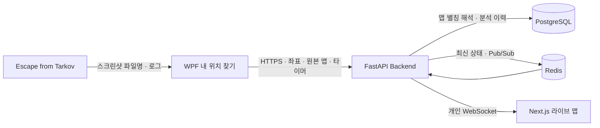

# 타르코프 도서관 · 내 위치 찾기

**갱신일: 2026.10.20**

[타르코프 도서관](https://eftlibrary.com)의 라이브 맵과 연동하는 **Windows x64 데스크톱 프로그램**입니다. C# · .NET 10 · WPF로 만들었으며, 현재 프로젝트 제품 버전은 **4.0.0**, 앱·파일 표시 버전은 **4.0.0.0**입니다.

게임이 생성한 스크린샷 파일명의 좌표와 application/output 로그의 맵·레이드 시작·타이머 기준을 백엔드로 전달합니다. 사용자 확인 후 실행 중에는 자동으로 감지하며, 게임 파일은 수정하지 않습니다.

[배포 파일](https://github.com/eft-library/eft-library-where-am-i/releases) · [로그 검증 샘플](tests/fixtures/raid-logs/README.md)

## 전체 서비스에서 맡은 역할



| 프로젝트       | 담당하는 일                                                                          |
| -------------- | ------------------------------------------------------------------------------------ |
| **Where Am I** | 파일 감지·로그 파싱·HTTPS 전송·데스크톱 상태 표시                                    |
| **Backend**    | 사용자 확인, 원본 맵의 별칭 해석, 상태 저장·발행, 배포 버전·경로 보고·분석 이력 처리 |
| **Frontend**   | 지도 자동 전환, 좌표 표시, 레이드 잔여 시간과 BTR 예상 운행 계산                     |
| **Airflow**    | 게임 기준 데이터 수집·화면용 JSON 생성·백업 등 정기 작업                             |

데스크톱은 PostgreSQL·Redis·웹 WebSocket에 직접 연결하지 않습니다. BTR의 실제 위치를 관측하는 프로그램도 아닙니다. 웹은 전달받은 레이드 시간과 사전 운행 데이터를 이용해 예상 위치·정차 시간을 계산합니다.

## 제공하는 기능

| 기능           | 현재 동작                                                                | 주요 코드                                                                                                                                  |
| -------------- | ------------------------------------------------------------------------ | ------------------------------------------------------------------------------------------------------------------------------------------ |
| 스크린샷 위치  | 게임 스크린샷 파일명에서 좌표 형식을 확인하고 파일명을 전송              | [ScreenshotLocationSender](where-am-i/Services/ScreenshotLocationSender.cs)                                                                |
| 로그 감지      | application/output 로그를 2초 간격으로 확인하고 추가된 부분을 읽음       | [TarkovLogMonitor](where-am-i/Services/TarkovLogMonitor.cs), [TarkovLogSessionReader](where-am-i/Services/TarkovLogSessionReader.cs)       |
| 실행 폴더 전환 | 새 게임 실행 폴더를 찾아 전환하고 이전 레이드 정보를 초기화              | [TarkovLogTargetSelector](where-am-i/Services/TarkovLogTargetSelector.cs)                                                                  |
| 레이드 상태    | 맵 로딩·시작·GameTimer 기준을 연결하여 변경 시 전송                      | [TarkovRaidSessionTracker](where-am-i/Services/TarkovRaidSessionTracker.cs), [RaidSessionSender](where-am-i/Services/RaidSessionSender.cs) |
| 전송 안정화    | 각 전송 API의 요청 직렬화, 최신 대기값 유지, 최대 3회 시도, 종료 시 취소 | [LatestJsonSender](where-am-i/Services/LatestJsonSender.cs)                                                                                |
| 상태·최근 활동 | 감지·전송 결과와 최근 활동 최대 100개, 오류 필터·표시 건수               | [ActivityHistory](where-am-i/Services/ActivityHistory.cs), [ConfirmedUserView](where-am-i/Views/ConfirmedUserView.xaml)                    |
| 앱 버전        | 사용자 확인 후 버전 조회, 별도 창에서 재확인·공식 다운로드 페이지 열기   | [VersionCheckService](where-am-i/Services/VersionCheckService.cs), [AppVersionView](where-am-i/Views/AppVersionView.xaml)                  |
| 경로 보고      | 직접 지정한 경로를 마스킹해 보고하고 완료 여부를 PC에 보관               | [PathReportService](where-am-i/Services/PathReportService.cs)                                                                              |
| 트레이         | 최소화 후 백그라운드 감지, 트레이에서 복원·종료                          | [TrayIconService](where-am-i/Services/TrayIconService.cs)                                                                                  |

최근 활동은 앱 실행 중에만 보관합니다. 맵 변경으로 지우지 않으며, 100개를 넘으면 가장 오래된 항목부터 제거합니다. ‘오류만’ 필터에서 빈 목록이 보여도 전체 기록이 삭제된 것은 아닐 수 있습니다.

## 설치와 사용

1. GitHub Releases에서 Windows x64 ZIP을 받아 새 폴더에 압축을 풉니다.
2. `where-am-i.exe`를 실행하고 EFT Library 계정 이메일로 **사용자 확인**을 진행합니다.
3. 스크린샷·로그 카드에서 자동으로 찾은 경로와 감지 상태를 확인합니다. 찾지 못하면 각 카드 상단의 폴더 선택 버튼으로 지정합니다.
4. 웹의 내 위치 찾기 지도를 열고, 지도 자동 전환이 필요하면 웹에서 해당 기능을 켭니다.
5. 게임 자체 스크린샷 기능으로 촬영하면 좌표를 전송합니다. 로그에 맵 로딩·시작·타이머가 기록되면 레이드 상태도 전송합니다.

배포 스크립트로 만든 패키지는 .NET 런타임을 포함하므로 사용자 PC에 별도 .NET 설치가 필요하지 않습니다. 소스에서 실행·빌드하려면 SDK가 필요합니다.

**감지 시작·중지 버튼은 없습니다.** 사용자 확인 후 자동 감지를 시작하고, 프로그램을 종료하면 파일 감시와 진행 중 요청을 취소합니다. 예전 설정에 감지 중지가 저장돼 있어도 자동 시작합니다.

로고 오른쪽에는 **현재 맵 열기·프로그램 종료**, 제목 오른쪽에는 **앱 버전** 버튼이 있습니다. 최소화하면 트레이에서 계속 실행되며, 창의 닫기 버튼은 프로그램을 종료합니다.

### 폴더를 직접 선택할 때

| 구분                     | 경로 예시                                                             |
| ------------------------ | --------------------------------------------------------------------- |
| 게임 스크린샷            | `C:\Users\사용자명\Documents\Escape from Tarkov\Screenshots`          |
| OneDrive 문서의 스크린샷 | `C:\Users\사용자명\OneDrive\Documents\Escape from Tarkov\Screenshots` |
| BSG 설치의 로그          | `C:\Battlestate Games\EFT\Logs`                                       |
| Steam 설치의 로그        | `D:\SteamLibrary\steamapps\common\Escape from Tarkov\build\Logs`      |

설치 드라이브와 위치는 사용자마다 다릅니다. 게임 설치 폴더를 열어 `Logs` 또는 `build\Logs`를 찾으세요. 안에 `log_날짜_시간_...` 폴더들이 보이면 **개별 실행 폴더 대신 상위 `Logs`를 선택**합니다. 아직 없다면 게임을 한 번 실행한 뒤 다시 확인합니다.

스크린샷은 Windows 문서·OneDrive·사진·Steam 관련 후보를 탐색합니다. 로그는 로컬 앱 데이터와 설치 레지스트리의 `Logs`·`build\Logs`를 탐색하며, Steam 라이브러리 전체를 직접 검색하지는 않습니다.

로그 경로를 직접 지정했다면 **그 범위만 탐색**합니다. 해당 경로가 없거나 비어 있어도 다른 설치 위치로 우회하지 않습니다. 새 실행 폴더에 application 로그가 생기면 다음 확인 주기에 전환합니다. 과거 파일의 수정 시각이 바뀌어도 같은 탐색 범위에서 이전 실행으로 돌아가지 않습니다.

프로그램을 먼저 켜고 게임을 나중에 실행해도 새 로그로 전환합니다. 다만 게임 프로세스의 실행 여부를 확인하지 않으므로 새 로그가 생기기 전에는 남아 있는 과거 최신 로그를 읽을 수 있습니다.

## 맵·타이머 전송 방식

### 맵 이름은 로그 원본을 보냅니다

클라이언트는 별칭 딕셔너리·별칭 API·로컬 캐시로 맵 이름을 변환하지 않습니다. rcid의 대소문자·밑줄을 보존해 `map` 필드로 보내고 백엔드에서 정식 맵을 찾습니다.

| 로그에서 읽어 보내는 `map` | 백엔드 `requested_map` | 백엔드가 매핑하는 `map_slug` 예시 |
| -------------------------- | ---------------------- | --------------------------------- |
| `bigmap`                   | `bigmap`               | `customs`                         |
| `city`                     | `city`                 | `streets-of-tarkov`               |
| `Rezerv_Base`              | `Rezerv_Base`          | `reserve`                         |
| `woods`                    | `woods`                | `woods`                           |

맵 로딩을 감지하면 레이드 시작을 기다리지 않고 맵·세션 정보를 먼저 보냅니다. 로그에서 맵 토큰 자체를 찾지 못하면 `map=null`입니다. 시작 시 읽을 로그가 없거나 새 실행 로그에 아직 정보가 없으면 맵·시작·타이머가 모두 없는 상태도 전송될 수 있습니다. `is_active=false`는 시작 미확보를 뜻하며 정확한 종료 판정이 아닙니다.

원본 이름을 정식 맵으로 바꾸고 웹에 전달하는 일은 백엔드 담당입니다. 별칭 누락은 서버 DB에서 수정합니다. ‘현재 맵 열기’도 원본 이름이 유효한 웹 경로와 같으면 직접 열고, 변환이 필요하면 `/live-map` 진입점을 열어 웹의 자동 전환을 사용합니다.

### 타이머는 종료 예정 시각을 기준으로 전달합니다

output 로그의 `GameTimer`에는 `utcNow`·`start`·`escape`가 있습니다. 클라이언트는 레이드 시작과 연결한 뒤 `timer_observed_at`·`raid_ends_at`을 UTC로 전송합니다. `session_id`는 실행 폴더와 레이드 기준 시각을 해시한 값으로, 로컬 경로 자체는 전송하지 않습니다.

웹은 `raid_ends_at − 현재 시각`으로 잔여 시간을 계산합니다. 앱에 표시하는 시간은 **로그 기록 당시 값**이며 실시간 카운트다운이 아닙니다. 타이머가 없으면 임의의 35분·40분을 만들지 않고 두 필드를 null로 보냅니다. 맵 변경 시 이전 타이머도 초기화합니다.

현재 연동 백엔드는 타이머가 포함된 미등록 맵을 `422 RAID_MAP_UNRESOLVED`로 거절하므로 해당 별칭을 등록해야 합니다. 클라이언트는 이 오류를 성공으로 표시하지 않습니다. HTTP 성공과 `data:true`를 확인한 전송 완료도 웹 화면 반영까지 보장하는 것은 아닙니다.

정확한 종료 감지, 실제 트랜짓 연결, 로그 기반 좌표, 실제 BTR 도착·출발 감지는 현재 범위에 포함하지 않습니다. 좌표는 스크린샷 방식, BTR은 웹의 운행표 기반 예측을 사용합니다.

## API와 로컬 설정

현재 기본 API 주소는 `https://back.eftlibrary.com`입니다.

| 요청                                      | 용도                                                |
| ----------------------------------------- | --------------------------------------------------- |
| `POST /api/where-am-i/check-wpf-user`     | 이메일 사용자 확인                                  |
| `POST /api/where-am-i/send-location`      | 좌표가 포함된 스크린샷 파일명 전송                  |
| `POST /api/where-am-i/v3/send-raid-state` | 로그 원본 맵·레이드 시작·세션·타이머 전달           |
| `POST /api/where-am-i/v3/path-reports`    | 직접 지정한 경로의 마스킹 보고                      |
| `POST /api/where-am-i/v3/check-version`   | 제품·현재 버전·플랫폼·아키텍처·채널로 업데이트 확인 |

스크린샷 이미지와 원본 게임 로그 전체는 업로드하지 않습니다. 위치·레이드 요청은 이메일로 사용자를 구분합니다. 경로 보고는 이메일 없이 종류·마스킹한 경로·앱 버전만 보내며, 사용자 폴더명과 이메일 형태를 가려도 임의 폴더명·공유명은 남을 수 있습니다.

설정은 기본적으로 `%LocalAppData%\EFTLibrary\WhereAmI` 아래에 저장합니다.

| 파일                     | 내용                                             |
| ------------------------ | ------------------------------------------------ |
| `settings.json`          | 이메일 저장 선택·저장 이메일·최초 안내 표시 여부 |
| `screenshot-path.txt`    | 직접 선택한 스크린샷 경로                        |
| `log-path.txt`           | 직접 선택한 로그 경로                            |
| `path-report-state.json` | 경로 종류와 해시에 기반한 수집 완료 상태         |

지정 경로 보고에 성공하면 반복하지 않고, 실패한 항목은 다음 실행의 사용자 확인 후 다시 시도합니다. 실제 감지는 PC에 저장된 원본 경로를 사용합니다. 과거 `map-aliases.json`은 더 이상 읽지 않습니다.

## 디렉터리 구조

```text
.
├── where-am-i/
│   ├── Models/               # 레이드 상태·전송 DTO·활동 항목
│   ├── Services/             # 로그·스크린샷 감지, 파싱, API 전송, 설정·트레이
│   ├── ViewModels/           # 사용자 확인·상태 화면의 명령과 상태
│   ├── Views/                # 사용자 확인·감지 화면·앱 버전 창
│   ├── Properties/PublishProfiles/
│   ├── App.xaml              # 공통 어두운 테마·버튼 스타일
│   └── where-am-i.csproj     # .NET 10 WPF · Windows x64
├── tests/
│   ├── RaidSessionChecks/    # 실제 서비스 코드를 연결하는 C# 검사
│   ├── fixtures/raid-logs/   # 개인정보를 제외한 맵·시작·타이머 샘플
│   └── test_raid_log_fixtures.py
├── tools/                    # 로그 재생·Release 패키징
└── artifacts/                # 로컬 패키지·해시·manifest, Git 제외
```

개인 원본 로그를 넣는 `log/`, `bin/`, `obj/`도 Git에서 제외합니다. 버그 재현 자료는 필요한 맵·시작·타이머 행만 정제해 fixtures에 추가합니다.

## 개발 환경과 검증

**.NET 10 SDK**와 **Python 3**을 사용합니다. WPF UI 실행은 Windows에서만 가능합니다. 저장소 루트 기준 명령입니다.

```sh
# Windows에서 앱 실행
dotnet run --project where-am-i/where-am-i.csproj

# 플랫폼에 독립적인 C# 서비스 검사와 Python 샘플 검사
dotnet run --project tests/RaidSessionChecks/RaidSessionChecks.csproj -c Release
python3 -m unittest discover -s tests -p 'test_*.py' -v

# Windows 대상 Release 빌드 — macOS에서도 교차 빌드 가능
dotnet build where-am-i/where-am-i.csproj -c Release -p:EnableWindowsTargeting=true
```

C# 검사는 가짜 HTTP 핸들러와 임시 파일을 사용하며 운영 API에 요청하지 않습니다. 디렉터리 심볼릭 링크 검사에는 Windows 개발자 모드 또는 링크 생성 권한이 필요합니다. macOS에서는 Windows Registry 코드의 플랫폼 경고가 발생할 수 있습니다.

앱 자체는 현재 운영 API 주소로 실행됩니다. 로컬 백엔드로 개발할 때는 [UserService](where-am-i/Services/UserService.cs)와 [ConfirmedUserViewModel](where-am-i/ViewModels/ConfirmedUserViewModel.cs)의 API 기본 주소를 함께 조정합니다. 환경 변수로 API 주소를 바꾸는 기능은 현재 없습니다.

정제 로그만 파일로 재생하려면 다음 도구를 사용합니다. 목적지는 존재하지 않는 새 폴더여야 합니다.

```sh
python3 tools/replay_raid_logs.py customs-woods
python3 tools/replay_raid_logs.py reserve-underscore --speed 60 --destination ./artifacts/replay-reserve
```

이 도구는 로그 파일을 재생할 뿐 앱이나 API를 실행하지 않습니다. 실제 Windows 게임 실행·UI·DPI·서버·웹 BTR 연동은 별도로 확인합니다. 서비스 검사·교차 빌드 성공과 실제 게임 환경의 검증은 구분합니다.

## Release 패키징

```sh
python3 tools/package_release.py --version 4.0.0
```

.NET 실행 파일이 PATH에 없다면 `--dotnet /path/to/dotnet`을 지정합니다. Windows에서는 환경에 따라 `python3` 대신 `python`을 사용합니다.

기본 명령은 C#·Python 검사 후 Windows x64 Release를 publish하고 다음 산출물을 만듭니다.

- `artifacts/where-am-i-4.0.0-win-x64.zip`
- `artifacts/where-am-i-4.0.0-win-x64.zip.sha256`
- `artifacts/where-am-i-4.0.0-win-x64.manifest.json`

패키지는 self-contained 단일 실행 파일과 `README.md`·간단 실행 안내 `README.txt`·`LICENSE`·파일별 해시 `manifest.json`을 포함합니다. 별도 관리하는 `docs/`나 이미지 폴더에는 의존하지 않습니다. ReadyToRun·trimming은 사용하지 않으며, 원본 로그·사용자 설정·테스트 샘플은 포함하지 않습니다. 같은 소스를 이미 검증한 경우에만 `--skip-tests`로 반복 검사를 생략합니다.

같은 버전으로 다시 실행하면 로컬 결과를 교체합니다. 공개 배포할 수정본은 새 버전을 지정하고, ZIP과 실행 파일 해시로 실제 사용 파일을 구분하세요. 패키징 스크립트는 서명·업로드·공개 배포·백신 검사를 수행하지 않습니다. 과거 배포본의 화면·백신 검사 결과는 새 파일의 검증 결과를 대신하지 않습니다.

## 연관 저장소

- [Frontend](https://github.com/eft-library/eft-library-front): 지도·레이드 타이머·BTR 및 사용자 화면
- [Backend](https://github.com/eft-library/eft-library-back): 데스크톱 API·맵 별칭·분석 이력·WebSocket
- [Airflow](https://github.com/eft-library/eft-library-airflow): 게임 데이터 갱신·정적 JSON·DB 백업
