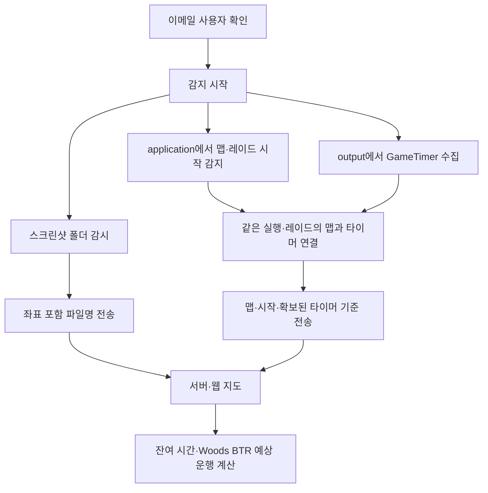

# 내 위치 찾기 기능 현황과 확장·디자인 개편 계획

최종 요구사항 갱신: 2026-10-19. 기존 구현 설명은 소스 검토 기준이며, 아래 확정 범위는 앞으로 구현할 기준이다.

2026-10-19 추가 검증: 제공된 실제 로그 5개 실행 폴더의 분석은 [실제 로그 기반 개발 가능 범위](LOG_ANALYSIS_2026-10-19.md)를 참고한다. Customs·Woods·Shoreline의 맵·시작 기록을 확인했으며, 플레이어 좌표·BTR 정차·실제 트랜짓 연결은 해당 샘플에서 확인되지 않았다. 아래 기존 구현 설명과 제안의 검증 범위는 이 분석 결과와 함께 해석한다.

이 문서는 기능을 추가하고 UI를 개편할 때 참고할 개발 기준 문서다. 현재 구현, 확인되지 않은 동작, 향후 제안을 구분한다. 제공된 실제 EFT 로그는 확인했으나 서버 구현·연동을 확인한 결과는 아니며, 코드가 있다는 이유만으로 게임·서버·웹 지도 연동까지 완료된 것으로 보지 않는다.

## 1. 목표와 현재 단계

프로그램은 Windows에서 실행되는 EFT Library 연동 도구다. 사용자 이메일을 확인하고, 게임 스크린샷 파일명과 application 로그를 읽어 위치 및 레이드 상태를 서버로 전달한다. 게임 파일을 수정하지 않는다.

### 이번 개발 확정 범위

- 좌표 수집·전송은 기존 스크린샷 방식을 유지한다. 로그 XYZ 추출은 이번 개발 범위에서 제외한다.
- `application` 로그로 현재 맵과 레이드 시작을 감지한다. Customs·Woods·Shoreline부터 검증하고 이후 전체 맵으로 확장한다.
- 같은 실행 폴더의 `output` 로그에서 `GameTimer`를 읽어 현재 맵의 타이머 기준을 수집한다. Woods는 BTR 예상 운행을 위한 타이머 확보·검증 대상이다.
- Customs·Shoreline은 타이머 기록이 없어도 맵 감지와 스크린샷 위치 전달을 계속한다. 이번 샘플에는 타이머가 있지만 모든 환경에서 기록된다고 가정하지 않는다.
- 서버·웹이 전달받은 타이머 기준으로 잔여 시간과 BTR 예상 운행·정차 정보를 계산하고 표시한다. 클라이언트가 BTR 도착·정차·출발 로그를 수집할 필요는 없다.
- 실제 트랜짓 연결과 정확한 레이드 종료·탈출·사망 감지는 이번 개발 범위에서 제외한다. 새 레이드의 맵·시작·타이머가 확인되면 이전 정보를 교체한다.
- 상태 화면에는 맵, 타이머 확보 여부, 스크린샷 위치 출처, 서버 전달 상태와 활동 이력을 구분한다. 타이머가 없으면 임의의 시간으로 자동 시작하지 않고 웹의 수동 입력·시작을 유지한다.

기존 종료·트랜짓·로그 좌표 코드는 현재 구현 설명으로 남긴다. 아래 과거 확장 제안과 충돌하면 이 확정 범위가 우선하며, 해당 기능 검증을 이번 완료 조건으로 요구하지 않는다.

### 구현 상태

| 기능 | 현재 소스 상태 | 추가 확인 또는 작업 |
| --- | --- | --- |
| 이메일 사용자 확인 | 구현됨 | 서버 오류와 미등록 사용자 UX 구분 |
| 이메일 저장 | 구현됨 | 계정 변경 흐름 설계 |
| 사용자 확인 후 버전 확인 | 클라이언트 구현됨 | API 미구현. 현재 버전·결과·재확인·다운로드 페이지 UI 준비 |
| 스크린샷 자동 경로 탐색·수동 지정 | 구현됨 | 다양한 설치 환경 확인 |
| 스크린샷 파일명 전송 | 구현됨 | 실제 파일명·웹 지도 반영 확인 |
| 로그 자동 경로 탐색·수동 지정 | 구현됨 | BSG·Steam 설치 환경별 확인 |
| 사용자 지정 경로 수집 | 클라이언트 구현됨 | 마스킹·최초 수집·완료 기록·다음 실행 재시도. 운영 DB 저장은 미검증 |
| 맵·레이드 시작 감지 | 구현됨 | 세 맵부터 검증, 종료·트랜짓 연결은 범위 제외 |
| output GameTimer 수집 | 구현됨 | 증분 읽기·레이드 연결·화면 확보 상태 표시, Windows 실제 실행 검증 필요 |
| 타이머 서버 전송 | 클라이언트 구현됨 | 기존 API에 필드 추가. 백엔드·웹 구현 및 운영 연동은 미완료 |
| 로그 XYZ 좌표 추출 | 파서 보존, 감시·전송 연결 제거 | 이번 범위 제외, 좌표는 스크린샷 사용 |
| 스크린샷·로그 감지 일괄 시작/중지 | 구현됨 | 처리 중인 작업의 중지 정책 보완 |
| 트레이 최소화·열기·종료 | 구현됨 | 개편 화면과 상태 표시 연계 |
| 최근 활동·오류 필터 | 구현됨 | 메모리 최대 100개. 진단 복사·영구 보관은 후속 |
| 레이드·스크린샷 전송 안정화 | 구현됨 | 요청별 직렬화·최신값·제한적 재시도·취소. 서버 전역 순서 보장은 후속 |
| 상태 화면 개편 | 1차 구현됨 | 실제 Windows 화면·키보드·DPI 검증 필요 |

클라이언트는 [구현 단계표](IMPLEMENTATION_ROADMAP.md)의 12단계까지 로컬 구현·통합 검사·Release 패키지 준비를 완료했다. 백엔드·웹 구현과 실제 Windows 게임 연동 검증은 별도다.

## 2. 확정한 목표 데이터 흐름

아래는 목표 흐름이다. 클라이언트의 application·output 수집·레이드 연결·타이머 포함 요청 전송은 구현했다. 백엔드의 필드 수신·WebSocket 전달과 웹 적용은 [백엔드 API 요구사항](BACKEND_API_REQUIREMENTS.md)에 따라 후속 구현한다.



클라이언트 지도 버튼은 외부 브라우저를 연다. 타이머가 없는 맵에서도 위치 전달은 유지한다. 실제 BTR 운행을 관측한 정보가 아니므로 웹은 예상 정보로 표시한다.

## 3. 기존 스크린샷 기능 상세

### 3.1 사용자 확인

- `UserService`가 이메일을 `/api/where-am-i/check-wpf-user`에 POST한다.
- HTTP 성공과 JSON의 `data: true`를 확인한다.
- 사용자 확인 후 감시 화면으로 이동한다.
- 이메일 저장 설정에 따라 로컬 이메일을 저장하거나 제거한다.
- 이메일 확인은 현재 계정 연결 수단이다. 인증 토큰을 사용하는 로그인과 동일한 것으로 간주하지 않는다.

### 3.2 폴더 탐색과 감시

`ScreenshotPathService`가 Windows 문서·사진 폴더, OneDrive 문서, Steam 관련 경로 및 저장된 사용자 지정 경로를 탐색한다. 실제 존재하는 경로에 `FileSystemWatcher`를 연결한다.

- 하위 폴더는 감시하지 않는다.
- 새 파일의 `Created` 이벤트를 처리한다.
- 경로는 15초마다 다시 탐색한다.
- 사라진 폴더의 감시를 해제한다.
- 감시 오류 시 해당 감시기를 제거하고 이후 경로 탐색에서 재연결을 시도한다.
- 화면 목록에는 현재 감시 중인 스크린샷 경로가 표시된다.

### 3.3 파일 필터와 전송

`ScreenshotLocationSender`가 파일명 필터·중복 억제·저장 대기·위치 전송을 담당한다. 파일명에 쉼표로 구분된 숫자 좌표 세 개와 PNG/JPG/JPEG 확장자가 있어야 한다. 음수·소수·대문자 확장자를 허용한다. 이미지에서 좌표를 읽거나 바이너리를 업로드하지 않는다.

- 같은 전체 경로의 3초 이내 반복 이벤트는 무시한다. 최근 경로는 1분이 지나면 정리한다.
- 유효 스크린샷을 감지한 시점에 최신 순번을 예약한다. 저장 준비를 기다리던 이전 파일과 이전 전송의 재시도는 더 최신 파일이 감지되면 생략한다.
- 파일이 읽기 가능하고 길이가 0보다 커질 때까지 최대 20회 확인한다. 빈 파일·I/O 오류·권한 오류도 다음 확인을 시도하며, 확인 사이 200ms를 기다린다. 게임의 실제 저장 완료를 완벽하게 보증하는 판정은 아니다.
- HTTP 요청은 스크린샷끼리 한 번에 하나만 전송한다. 이전 요청 뒤 대기하던 중간 위치는 버리고 최신 위치만 보낸다.
- 요청은 기존 POST `/api/where-am-i/send-location`의 `email`, `location`(파일명) 두 필드를 유지한다. 전체 경로·이미지·새 메타데이터는 보내지 않는다.
- `LatestJsonSender`가 레이드·스크린샷에 공통으로 HTTP 성공과 `data:true`를 검사한다. HTTP 시간 초과·네트워크/I/O 오류·408·429·5xx만 총 3회까지 시도하며 1초·2초를 기다린다. 영구 4xx·논리 실패·잘못된 JSON은 반복하지 않는다.
- 감지 중지·앱 종료 시 파일 준비 대기·HTTP·재시도 대기를 취소하고 이전 진행 알림을 무효화한다. 오래된 결과로 최신 전송 상태를 덮어쓰지 않는다.
- 파일 준비·전송 대기·전송 중·재시도·최종 결과를 화면에 구분한다. 이미 무효화·취소된 작업은 최신 결과나 오류 이력으로 게시하지 않는다. 확정된 실패 이력은 나중 성공으로 지우지 않는다.

스크린샷 파일을 영구 큐에 보관하거나 감지 재개 시 과거 파일을 다시 보내지는 않는다. 최종 실패 또는 중지 후에는 게임에서 새 스크린샷을 촬영한다. 레이드 스냅샷과 스크린샷은 각각 직렬화하며 두 API 사이의 전역 순서·서버에서 이미 처리 중인 요청의 롤백까지 보장하지 않는다.

## 4. 로그 기능 상세

### 4.1 로그 경로 탐색

사용자가 제공한 EFT 로그 폴더 위치는 `C:\Battlestate Games\EFT\Logs`다. 해당 위치에 게임을 설치한 환경에서는 로그 폴더 수동 지정 시 이 경로를 선택한다. 설치 위치에 따라 실제 경로는 달라질 수 있다.

`TarkovLogPathService`가 다음 후보를 만든다.

1. 사용자가 마지막으로 지정한 로그 폴더.
2. `%LocalAppData%\Battlestate Games\EscapeFromTarkov\Logs`.
3. Windows 설치 레지스트리의 `InstallLocation` 아래 `Logs`.
4. 같은 설치 위치 아래 `build\Logs`.

현재 로그 경로 탐색에는 스크린샷 서비스와 같은 Steam 라이브러리 직접 탐색 로직이 없다. Steam 환경에서 레지스트리 후보로 충분한지 확인하고, 필요하면 탐색을 확장한다.

사용자가 지정한 경로는 단일 경로로 원자적으로 저장된다. 지정 경로가 있으면 해당 범위만 탐색하며 접근 실패에도 자동 후보로 우회하지 않는다. 지정 경로가 없을 때만 자동 탐색한다. Logs 바로 아래의 인식 가능한 실행 폴더를 선택했다면 부모 Logs에서 다음 실행도 찾는다. 저장·경로 보고는 원래 선택한 경로를 유지한다.

### 4.2 읽을 파일 선택과 주기

`TarkovLogMonitor`는 시작 즉시 한 번 실행하고 이후 2초 간격으로 확인한다. 지정 범위에서 `TarkovLogTargetSelector`가 `log_yyyy.MM.dd_H-m-s_...` 폴더명의 시각으로 최신 실행을 선택한다. 인식 가능한 이름이 우선이며 나머지는 최초 발견 시 고정한 디렉터리 생성 시각을 사용한다. 링크·정션은 따라가지 않는다. 같은 범위에서는 과거 실행으로 돌아가지 않고, 최신 대상 삭제 시 기다린다. 경로 변경·앱 재시작 시 선택 기준을 초기화한다. 새 폴더에 application 파일이 생기면 전환하며 빈 폴더만으로는 전환하지 않는다. 게임 프로세스 실행 여부는 확인하지 않는다. `TarkovLogSessionReader`는 해당 실행 폴더 안의 application·output `.log` 파일만 함께 읽는다.

- 최초 선택·앱 중간 실행 시 파일 처음부터 읽어 과거 맵·시작·타이머 기준을 복구한다. 원본 전체를 메모리에 보관하지 않는다.
- 이후에는 파일별 바이트 오프셋부터 새로 추가된 부분만 읽는다. application 변경 없이 output만 추가돼도 처리한다.
- 줄바꿈 전까지의 부분 행과 UTF-8 바이트를 보관하고 다음 폴링에서 완성한다. 64KiB를 초과하는 행은 줄바꿈까지 건너뛰어 메모리를 제한한다.
- 파일은 게임의 쓰기·삭제를 허용하는 공유 모드로 연다. 폴링 시작 시 파일 길이까지만 읽어 계속 쓰는 파일 때문에 작업이 끝없이 이어지지 않게 한다.
- 파일 잘림, 생성 시각 변경, 동일 길이의 수정 또는 읽은 끝부분 64바이트 변경을 감지하면 같은 실행 폴더의 상태를 다시 구성한다. 파일 목록 변경·회전·삭제도 재구성한다.
- 파일 읽기 실패 시 다음 폴링에서 실행 폴더의 모든 관련 파일을 다시 읽어 형제 파일의 이벤트가 누락되지 않게 한다.
- 실행 폴더 변경·재검색 시 reader를 교체한다. application을 찾지 못하면 이전 맵·타이머 상태를 비운다.
- `SemaphoreSlim`으로 폴링 중복을 막고 중지·종료 전 시작된 읽기 결과는 실행 세대를 확인하여 버린다.

파일 교체 감지는 위 메타데이터·끝부분 비교 기준이다. 내용·길이·메타데이터·끝부분이 모두 같은 상태로 보존되는 임의 수정까지 검출하는 전체 파일 해시는 수행하지 않는다. 과거의 마지막 500,000바이트 제한은 제거했다.

### 4.3 맵 판별

다음 패턴 종류를 순서대로 검사한다.

1. `rcid:...scenespreset`
2. `maps/...bundle`
3. `Locations: ...`
4. `Location: ...,`

각 종류의 마지막 매치에서 맵 이름을 추출하고 가장 우선하는 종류의 원본 이름을 반환한다. rcid가 있으면 대소문자·밑줄을 보존하며 `bigmap`, `city`, `Rezerv_Base`를 그대로 전송한다. 번들 fallback은 경로와 `_preset.bundle` 파일 접미사를 제외한 이름을 추출한다. 클라이언트는 별칭 사전 조회·정식 slug 변환을 하지 않는다. 맵 토큰 자체를 추출하지 못했을 때만 null이다.

별칭 해석은 백엔드가 수행하고 requested_map에 받은 원본, map_slug에 정식 맵을 저장한다. 타이머는 로딩 당시에는 null이고 시작·유효 GameTimer가 있으면 원본 맵과 함께 전송한다. 웹의 맵 이동·BTR 적용은 서버가 매핑한 정식 맵을 사용한다.

### 4.4 현재 레이드 연결

`TarkovRaidSessionTracker`는 실행 폴더마다 별도 인스턴스를 사용한다. application의 scene preset·GameStarted와 output의 GameTimer를 로컬 행 시각순으로 연결하므로 파일을 읽는 순서가 달라도 같은 상태로 복구한다.

- 새 scene preset은 맵을 교체하고 이전 시작·타이머를 비운다. 알 수 없는 맵도 이전 맵을 유지하지 않는다.
- GameStarted는 현재 로딩에 시작 시각을 연결한다. 새로운 로딩 없이 시작이 반복되면 이전 레이드 타이머를 재사용하지 않는다.
- GameTimer는 같은 로딩 구간에 연결하고 내부 utcNow/start/escape를 UTC로 해석한다. 잘못된 시간 형식·시작 이후가 아닌 관측·이미 만료된 기준은 무시한다.
- 중복 행은 재처리하지 않는다. 늦게 도착한 이전 맵의 타이머도 시각순으로 다시 해석하여 현재 맵에 붙이지 않는다.
- `SessionChanged`에서 맵·시작·타이머 스냅샷을 직렬 전송한다. 화면 요약도 `SessionChanged`에서 갱신하고 `StateChanged`는 감시기의 호환 이벤트로 남긴다. 전송의 is_active는 시작 감지 여부이며 transit_count는 0이다.

정확한 종료·실제 트랜짓 연결은 수행하지 않는다. 새 로딩·시작이 없으면 이전 레이드 기준은 남을 수 있다. 화면 타이머는 기록 당시 잔여 시간과 기준 시각이며 실시간 카운트다운이 아니다. Woods 미확보 상태와 Customs·Shoreline 타이머 누락에서도 스크린샷 전달은 유지한다.

### 4.5 로그 위치 추출: 보존된 기존 파서, 이번 범위 제외

아래는 기존 파서의 동작 설명이다. 감시기의 로그 위치 이벤트와 ViewModel의 로그 좌표 전송 연결은 제거했으며 현재 위치 전달은 스크린샷 방식만 사용한다.

새 `LogLocation` 모델은 `X`, `Y`, `Z`, `ObservedAt`을 보관한다.

파서가 찾는 형태의 설명용 예시는 다음과 같다. 실제 게임에서 확보한 샘플은 아니다.

```text
2026-10-08 21:15:30.123 ... Position:(123.4, 5.6, -78.9)
```

- 행 시작에 날짜·시각이 있어야 한다.
- `Position:(...)`의 대소문자와 구두점이 현재 정규식과 일치해야 한다.
- 좌표는 음수와 소수를 허용하며 지수 표기나 `+` 접두사는 지원하지 않는다.
- 정규식은 소수 초 자릿수를 여러 개 허용하지만, 시각 파싱은 `fff` 형식이다. 세 자리 이외의 소수 초는 검증이 필요하다.
- 시각은 실행 PC의 로컬 시간으로 해석한다.
- 레이드 시작 시각보다 이전인 위치는 제외한다.
- 매칭된 순서에서 마지막 유효 위치를 반환한다. 시각으로 별도 정렬하지 않는다.
- 활성 레이드로 판단했을 때만 위치를 추출한다.
- 직전 위치와 레코드가 다르면 이벤트를 발생시킨다. 좌표가 같아도 관측 시각이 다르면 새 위치로 취급한다.

이 기능은 게임이 `Position` 정보를 기록할 때만 위치를 얻을 수 있다. 로그 감지 주기가 2초라는 이유로 게임 좌표도 2초마다 생성되거나 연속 추적된다고 안내하면 안 된다.

## 5. 서버 전송 계약: 클라이언트 기준

기본 주소: `https://back.eftlibrary.com`. 아래 표는 현재 클라이언트가 보내는 요청이다. 인접 백엔드 소스에서 기존 레이드 API를 확인했으나 새 타이머 필드는 아직 구현되지 않았다. 새 필드 지원은 백엔드 구현·배포 후 확인해야 한다.

| 목적 | POST 경로 | 필드 | 클라이언트 성공 판정 |
| --- | --- | --- | --- |
| 사용자 확인 | `/api/where-am-i/check-wpf-user` | `email` | HTTP 성공 + `data: true` |
| 스크린샷 위치 | `/api/where-am-i/send-location` | `email`, `location` | HTTP 성공 + `data: true` |
| 레이드 상태·타이머 | `/api/where-am-i/v3/send-raid-state` | 기존 필드 + `session_id`, `timer_observed_at`, `raid_ends_at` | HTTP 성공 + `data: true` |

스크린샷·레이드 요청은 감시 화면의 공용 `HttpClient`를 사용하며 제한 시간은 15초다. 사용자 확인 서비스는 별도의 클라이언트를 사용한다.

### 과거 로그 위치 요청 예시 — 현재 전송 연결 제거

```json
{
  "email": "player@example.com",
  "map": "customs",
  "x": 123.4,
  "y": 5.6,
  "z": -78.9,
  "observed_at": "2026-10-08T21:15:30.123+09:00"
}
```

### 레이드 상태 요청 예시

```json
{
  "email": "player@example.com",
  "map": "customs",
  "started_at": "2026-10-08T21:10:00+09:00",
  "is_active": true,
  "transit_count": 0
}
```

맵 또는 시작 시각은 파싱 결과에 따라 `null`일 수 있다. 과거 로그 좌표 전송 구조는 참고용이며 현재 연결은 제거했다.

레이드 스냅샷은 직렬 전송하고 대기 중인 과거 값은 버린다. 스크린샷 전송은 독립 비동기 요청이다. 레이드 요청에는 해시 기반 session_id가 있지만 전역 순서 번호는 없다. 시간 초과 이후 서버에서 늦게 처리되는 요청의 순서 정책은 백엔드에서 별도로 확정한다.

### 5.1 레이드 타이머 전달과 BTR 예상 운행 — 확정 방향

클라이언트는 현재 맵과 `output`의 `GameTimer` 기준을 전달하고, 서버·웹이 레이드 잔여 시간과 BTR 예상 운행을 계산한다. BTR 자체 이벤트 수집은 필요하지 않다. Woods를 우선 검증하며 Customs·Shoreline에서는 타이머 누락을 허용한다.

실제 Woods 샘플은 다음과 같다.

```text
GameTimer utcNow:10/18/2026 23:40:32 start:10/18/2026 23:40:32 escape:10/19/2026 00:15:32 PastTime:00:00:00
```

기록 당시 잔여 시간은 `escape - utcNow`로 35분이다. 고정 35분을 하드코딩하지 않고 실제 기록값을 사용한다. 내부 시각은 UTC 해석 근거가 있으나 행 시각과 초 단위 차이가 있어 실제 게임 화면과 동기화를 검증한다. 늦은 입장·재접속은 별도 검증 대상이다.

#### 클라이언트 전송 계약과 백엔드 후속 요구사항

별도 BTR API를 만들지 않고 기존 POST `/api/where-am-i/v3/send-raid-state`에 `session_id`, `timer_observed_at`, `raid_ends_at`을 추가하여 전송한다. 타이머가 없으면 두 시간은 명시적 null이다. 시작과 맵을 확인하기 전에는 타이머를 포함하지 않는다.

클라이언트는 HTTP 성공과 응답의 data:true를 확인하고 일시 오류만 총 3회까지 시도한다. 감지 중지·종료 시 전송을 취소하고, 재개하면 같은 스냅샷도 다시 전달한다. 화면의 요청 성공은 웹 타이머 적용 완료를 의미하지 않는다.

백엔드·웹 코드는 이번 작업에서 수정하지 않았다. 현재 백엔드 모델은 새 필드를 무시할 수 있으므로 구버전 서버의 성공 응답만으로 타이머 지원 여부를 확정할 수 없다. 필드 검증·기존 응답 형식·WebSocket·60초 캐시 개선·웹 자동화 조건과 완료 기준은 [백엔드 API 요구사항](BACKEND_API_REQUIREMENTS.md)을 따른다.

#### 수집·화면 동작과 완료 기준

- 같은 실행 폴더의 application과 output을 함께 읽고 맵·시작·타이머를 같은 레이드에 연결한다. 새 맵에 이전 타이머를 연결하지 않는다.
- 큰 output 파일에서도 타이머 행을 놓치지 않도록 증분 읽기·상태 보관을 적용한다. 앱을 레이드 도중 실행해도 해당 레이드 기록 복구를 검증한다.
- 새 레이드로 전환하면 이전 타이머를 초기화하고 새 기준이 확인될 때 적용한다. 정확한 종료 감지와 실제 트랜짓 연결은 요구하지 않는다.
- Woods에서 타이머를 확보하면 웹 타이머를 자동 적용한다. 없으면 미확보 상태를 표시하고 기존 수동 입력·시작을 유지한다.
- Customs·Shoreline에서 타이머가 없어도 맵·스크린샷 위치 전달은 정상 동작해야 한다.
- 웹은 잔여 시간에 맞춰 BTR 예상 위치·정차 정보를 표시한다. 실제 정차 관측값으로 표시하지 않는다.

완료 기준: Woods의 실제 게임 잔여 시간과 웹 타이머의 동기화를 확인하고, 같은 맵 재입장·Customs → Woods·지연 전송·타이머 누락에서도 이전 레이드 값이 섞이지 않는다. 위치 전달은 기존 스크린샷 방식으로 유지한다.

### 5.2 백엔드에서 확인할 도메인과 API 계약

현재 문서의 기본 주소 `https://back.eftlibrary.com`은 클라이언트에 하드코딩된 값이다. 백엔드 소스와 배포 설정을 확인한 결과는 아니다.

- **라우트/컨트롤러/스키마:** 실제 API 경로, HTTP 메서드, 요청·응답 필드, 인증 방식, 오류 코드를 확인한다.
- **환경 설정:** 개발·운영 API 기본 주소와 환경별 차이를 확인한다. 설정 키와 필요한 값만 확인하며 비밀값을 문서에 복사하지 않는다.
- **배포·프록시·게이트웨이 설정:** 외부 공개 도메인, 경로 접두사, HTTPS 및 내부 서비스 연결을 확인한다.
- **OpenAPI 문서가 있다면:** 라우트와 데이터 계약의 참고 자료로 사용하고 실제 배포 설정과 함께 대조한다.

백엔드 기능 코드만으로 공개 도메인을 알 수 없는 경우가 있다. 공개 도메인은 배포 환경이나 프록시에서 정해질 수 있으므로 **기능 코드로 계약을 확인하고, 배포 설정으로 주소를 확인**한다.

인접 백엔드 저장소의 기존 레이드 API·모델·개인 WebSocket 전달 구조는 확인했다. 타이머 확장은 별도 요구사항 문서에 정리했으며, 실제 배포 설정·운영 반영과 맵 별칭·버전 API는 별도 검증한다.

## 6. 제어와 로컬 저장

감지 시작/중지는 스크린샷 감시와 로그 감시를 함께 제어한다. 중지하면 스크린샷 감시기·경로 갱신·로그 폴링을 멈추고 레이드·스크린샷 전송 요청·재시도와 스크린샷 준비 대기를 취소한다. 진행 중인 로그 읽기는 결과 게시를 막는다. 재개 시 레이드 스냅샷은 다시 읽어 전송하며 스크린샷은 새 파일 감지부터 처리한다.

설정 위치는 `%LocalAppData%\EFTLibrary\WhereAmI`다.

| 파일 | 내용 |
| --- | --- |
| `settings.json` | 버전 2, 이메일 저장 여부·이메일, 감지 활성 여부, 첫 안내 표시 여부 |
| `screenshot-path.txt` | 사용자 지정 스크린샷 경로 |
| `log-path.txt` | 사용자 지정 로그 경로 |
| `path-report-state.json` | 종류·원본 정규화 경로의 해시 기반 수집 완료 목록. 이메일·원본 경로는 추가 저장하지 않음 |

설정 파일 읽기 실패 시 기본 설정을 사용하는 처리가 있다. 이메일은 JSON에 평문 저장된다. 사용자 지정 경로는 각 파일에 하나씩 저장하며, 여러 사용자 지정 경로를 관리하는 UI는 없다.

## 7. 현재 UI와 한계

### 현재 구성 — 5단계 반영

- 사용자 확인 창은 기존 460×470을 유지한다.
- 감시 창은 기본 720×760, 최소 520×480이며 크기 조절과 전체 스크롤을 허용한다. 좁은 창에서 하단 버튼은 줄바꿈한다.
- 제목은 “위치·레이드 감지”다. 감지 켜짐·중지를 텍스트와 상태 점으로 표시하며 감지 켜짐을 서버 정상 연결의 의미로 사용하지 않는다.
- 레이드 카드: 맵·시작 감지 상태, 타이머의 기록 당시 값·기준 시각, 레이드 요청 전송 결과.
- 앱 버전 카드: 실행 버전, 업데이트 상태·확인한 최신/최소 버전·변경 내용·재확인과 다운로드 페이지. API 배포 전에는 확인 실패로 표시한다.
- 스크린샷 카드: 감시 상태와 위치 전송 대기·저장 대기·진행·성공·실패. 레이드 전송 상태와 분리한다.
- 로그 수집 카드: 읽기·미발견 상태. “감지 경로 보기”를 열면 실제 로그 실행 폴더·스크린샷 감시 폴더·종류별 경로 수집 결과와 마스킹 안내를 확인한다. 긴 경로는 축약하고 툴팁으로 전체를 표시한다.
- 최근 활동: 앱에서 기록한 시각·종류·메시지·오류 여부를 최신순으로 최대 100개 보관한다. “오류만” 필터를 제공한다. 정상 복구가 이전 실패를 덮어쓰지 않는다.
- 이력은 앱 메모리에만 있으며 종료 시 비워진다. 파일 저장·서버 업로드·진단 복사 기능은 없다. 이력의 시각은 앱이 기록한 시각이며 실제 게임 시작 시각과 다를 수 있다.
- “현재 맵 열기”는 감지한 정규화 맵을 연다. 미확인·지원하지 않는 값은 기존 기본값 Customs를 연다.

### 남은 확인·개선

- 실제 Windows에서 창 크기·125%·150%·200% DPI·키보드 탐색·스크롤을 검증해야 한다. 교차 빌드는 시각 검증을 대신하지 않는다.
- 스크린샷 좌표를 별도 위치 모델로 표시하거나 오래됨을 판정하는 기능, 실시간 타이머 카운트다운은 없다.
- 스크린샷 감지 순서로 최신값을 고르고 HTTP를 직렬화한다. 취소·무효화되지 않은 결과만 이력에 남긴다. HTTP 시간 초과·취소 이후 서버에서 이미 처리 중인 요청의 완료 순서는 별도 서버 정책이 필요하다.
- 진단 복사를 추가할 때는 이메일·Windows 사용자 경로 마스킹이 필요하다.
- 로고는 기존 원격 URL을 사용한다. 로컬 자산 전환은 후속이다.
- 정확한 종료 감지는 범위에서 제외했으므로 시작 감지는 실제 종료 여부의 보장이 아니다. 감지를 중지하면 마지막 레이드 정보를 유지한다고 표시한다.

## 8. 기존 코드 검토의 동작 한계와 개선 후보

아래는 개편 전 검토 기록이다. 마지막 500,000바이트 제한·파일 읽기 전 signature 저장·독립 로그 좌표 전송은 현재 감시기에서 제거했다. 최신 로그 읽기·레이드 연결 동작은 4.2·4.4를 따른다. 레이드·스크린샷 전송 모두 제한적 재시도·각 API별 직렬화·취소를 적용했다. 서버 전역 순서 정책은 별도 작업이다.

| 항목 | 현재 동작 또는 위험 | 개선 방향 |
| --- | --- | --- |
| 오래 진행한 레이드 | 시작 행이 마지막 500,000바이트 밖으로 밀리면 비활성으로 판단할 수 있음 | 파일별 읽기 위치와 세션 상태 유지 |
| 오래된 로그 선택 | 최근 수정 파일을 읽을 뿐 현재 게임 세션인지 확인하지 않음 | 로그 세션·신선도·사용자 지정 우선순위 정책 |
| 트랜짓 맵 판별 | 패턴 종류 우선순위 때문에 더 오래된 맵이 선택될 수 있음 | 위치·시각 기반 이벤트 순서 해석 |
| 위치 신선도 | 시작 이후 위치라도 오래된 좌표를 보낼 수 있음 | 관측 경과 시간과 오래됨 상태 표시 |
| 전송 실패 | 직전 감지값은 이미 저장되어 같은 값 자동 재시도 없음 | 감지 상태와 전달 완료 상태 분리 |
| 파일 읽기 실패 | 읽기 전 signature 저장으로 변경 없는 파일은 다음 폴링에서 생략 가능 | 읽기 성공 후 signature 확정 |
| 여러 입력의 경쟁 | 스크린샷과 로그가 각각 독립 전송 | 출처·시각·우선순위를 가진 공통 위치 모델 |
| 요청 순서 | 여러 비동기 전송이 겹칠 수 있음 | 큐·세션 ID·순서 번호·서버 중복 방지 |
| 중지·종료 | 진행 중 작업 취소와 종료 동기화가 제한적 | 취소 토큰 및 안전한 작업 종료 |
| 타임스탬프 | 로컬 시각·밀리초 형식에 의존 | 실제 샘플 기반 형식 지원과 시간대 계약 |
| 성공 표시 | 로그 API는 본문 의미를 확인하지 않음 | 공통 응답 계약 및 오류 코드 |

이 항목들은 코드 검토에서 도출한 개선 후보다. 실제 장애가 재현된 목록과는 구분한다.

## 9. 기능 확장 제안

아래 내용은 아직 구현되지 않은 제안이다. 기능 추가 전에 서버·웹 변경 범위를 함께 확정한다.

### 9.1 감지 상태와 연결 상태 분리 — 우선순위 P0

다음 정보를 독립 상태로 보관하고 화면에 표시한다.

- 감지 설정: 활성/중지.
- 스크린샷: 경로 미설정/감시 중/접근 오류.
- 로그: 파일 없음/감시 중/읽기 오류.
- 레이드: 미확인/대기/진행/트랜짓 감지.
- 위치: 없음/최신/오래됨, 출처, 관측 시각.
- 전송: 대기/전송 중/성공/실패, 마지막 성공 시각.

로그 파일을 정상적으로 읽었지만 좌표 행이 없으면 “로그 감지 중 · 위치 기록 대기”처럼 안내한다. 서버 연결됨 표시는 실제 요청 성공 또는 별도 상태 확인에 근거해야 한다.

완료 기준: 폴더 없음, 감지 중지, 좌표 없음, 전송 실패를 서로 다른 상태와 안내로 표현한다.

### 9.2 공통 위치 모델과 출처 정책 — P0

후보 모델: `PositionObservation(Map, X, Y, Z, ObservedAt, Source, SessionId)`.

- `Source`는 screenshot/log 등으로 구분한다.
- 좌표 관측 시각과 서버 전달 시각을 분리한다.
- 최신 관측을 우선하는 정책을 기본 후보로 삼되, 스크린샷 시각의 신뢰도를 먼저 확인한다.
- 맵이 불명확할 때 전송 보류 또는 서버 판별 중 어느 정책을 쓸지 결정한다.
- 오래된 위치의 경고 임계값은 실제 로그 발생 간격을 확인한 뒤 정한다.
- Y를 활용한 층 표시는 지도별 층 기준 데이터가 있어야 제공한다.

완료 기준: 두 출처가 동시에 들어와도 오래된 좌표가 최신 좌표를 덮어쓰지 않으며, 사용자가 출처와 시각을 볼 수 있다.

### 9.3 전송 큐와 재시도 — P0

현재 레이드·스크린샷 전송은 `LatestJsonSender`를 공유하여 요청별 직렬화·최신 대기값 유지·총 3회 이내 재시도·취소를 구현했다. 스크린샷은 `ScreenshotLocationSender`에서 준비 대기와 감지 순번을 관리한다. 아래 서버 전역 순서·영구 큐 정책은 추가 설계 대상으로 남긴다.

- HTTP 처리를 ViewModel에서 전송 서비스로 옮긴다.
- 성공한 전달값과 마지막으로 감지한 값을 별도로 관리한다.
- 일시 오류만 제한적으로 재시도하고, 사용자 확인 실패·유효하지 않은 요청은 명확히 안내한다.
- 위치 큐는 오래된 좌표를 계속 쌓기보다 최신 위치를 유지하는 정책을 검토한다.
- 레이드 시작/종료 이벤트는 위치와 달리 보존 순서가 중요하다.
- 중지 시 신규 수집과 재시도 중지 여부, 진행 중 요청 취소 정책을 정한다.
- 서버 변경 시 세션 ID·순서 번호·중복 방지 키를 함께 설계한다.

완료 기준: 일시적인 연결 실패 이후 최신 위치가 복구되며, 이전 레이드 데이터가 새 레이드를 덮어쓰지 않는다.

### 9.4 진단과 활동 이력 — P1

현재 메모리 최대 100개 이력과 오류 필터는 구현했다. 아래 진단 복사·보관 정책 확장은 후속 제안이다.

최근 이벤트를 시간·종류·내용·결과로 보관한다. 예: 로그 발견, 레이드 시작, 맵 변경, 위치 감지, 전송 실패, 감지 중지.

- 사용자가 이력 필터와 진단 정보 복사를 사용할 수 있게 한다.
- 기본 보관 개수와 기간을 정해 무제한 누적을 막는다.
- 진단 복사에는 이메일과 Windows 사용자 경로를 기본 마스킹한다.
- 원본 게임 로그 전체 업로드와 진단 요약 복사는 별도 기능으로 다룬다.

완료 기준: 마지막 메시지가 다른 이벤트로 덮여도 이전 실패 원인과 시각을 찾을 수 있다.

### 9.5 경로 및 설정 관리 — P1

- 탐색된 경로, 사용자 지정 경로, 실제 선택된 로그 파일을 구분한다.
- 경로 선택·폴더 열기·재검색·사용자 지정 경로 초기화를 제공한다.
- 스크린샷과 로그의 개별 활성화를 추가할지 결정한다.
- 여러 사용자 지정 경로가 필요하면 단일 txt 파일 구조를 설정 목록으로 이관한다.
- 계정 변경, 시작 시 트레이 실행, Windows 시작 시 실행은 별도 선택 설정으로 검토한다.

완료 기준: 사용자가 현재 어떤 파일을 읽는지 확인하고 자동 탐색 실패를 화면에서 해결할 수 있다.

#### 사용자 지정 감시 경로 DB 수집 — 사용자 확정 방향 (2026-10-17)

사용자가 직접 선택한 감시 폴더 경로를 백엔드로 전송하여 DB에 기록한다. 목적은 **사용자 환경의 경로 패턴을 분석하고 자동 경로 탐색을 개선하기 위한 로그 수집**이다. 백엔드 소스의 테이블 `where_am_i_path_reports`와 POST `/api/where-am-i/v3/path-reports`를 확인했고 클라이언트를 연결했다. 서버 코드·DB는 변경하지 않았으며 운영 배포·실제 DB 저장은 별도 검증이 필요하다.

수집 대상은 다음 두 종류다.

| 경로 종류 | 수집 값 | 분석 목적 |
| --- | --- | --- |
| 스크린샷 감시 폴더 | 사용자가 직접 지정한 스크린샷 폴더 경로 | 기본 탐색으로 찾지 못하는 저장 위치와 경로 패턴 파악 |
| 로그 감시 폴더 | 사용자가 직접 지정한 로그 폴더 경로 | 설치 방식·설치 위치에 따른 Logs 경로 패턴 파악 |

**서버 DB는 프로그램 설정 복원용으로 사용하지 않는다.** 프로그램 실행 시 DB에서 이 경로를 다시 가져오거나 감시 경로로 적용하지 않는다. 기존 로컬 `screenshot-path.txt`, `log-path.txt` 저장과 불러오기 흐름은 계속 사용한다. 자동 탐색 후보 전체나 사진·게임 로그 파일 내용은 이 수집 기능의 대상이 아니다.

권장 처리 흐름:

1. 사용자가 스크린샷 또는 로그 폴더를 직접 선택한다.
2. 클라이언트가 경로를 정규화하고 로컬 저장을 완료한다.
3. 기존 방식대로 감시 경로를 적용하거나 로그 재탐색을 요청한다.
4. 경로 종류와 지정 경로를 별도 수집 API로 비동기 전송한다.
5. 서버가 수집 시각과 함께 DB에 기록하여 패턴 분석에 사용한다.

경로 수집의 성공 여부는 실제 스크린샷 감지·로그 감지·위치 전송 성공과 별도로 관리한다. 수집 API가 실패하더라도 로컬 경로 저장과 감시 기능은 계속 동작하게 한다. 앱 시작 때 수집 완료한 기존 경로를 반복 전송하지 않는다. 다만 업데이트 전부터 사용하던 경로는 아래 최초 수집 절차로 전송한다.

기존 사용자 경로 최초 수집:

1. 수집 기능이 포함된 버전으로 업데이트한 사용자가 사용자 확인에 성공하면 기존 로컬 사용자 지정 경로를 읽는다.
2. 스크린샷·로그 경로 중 값이 있고 아직 수집 완료되지 않은 항목만 비동기로 전송한다. 사용자가 폴더를 다시 선택할 필요는 없다.
3. 서버가 저장 성공을 확인한 항목만 로컬에 수집 완료 상태를 기록한다. HTTP 응답뿐 아니라 합의된 성공 응답을 확인한다.
4. 실패한 항목은 완료로 표시하지 않고 다음 실행의 사용자 확인 성공 후 재시도한다. 한 경로의 성공이나 실패가 다른 종류의 수집 상태를 덮어쓰지 않는다.
5. 이후 사용자가 경로를 변경하면 새 경로 선택 흐름으로 전송한다. 실패한 새 경로도 다음 실행 시 재시도 대상에 포함한다.

수집 완료 상태는 경로 종류와 정규화된 경로를 기준으로 구분한다. 프로그램 버전이 바뀌었다는 이유만으로 같은 경로를 다시 최초 수집하지 않는다. 경로 변경 중 이전 요청이 완료되어도 새 경로를 수집 완료로 잘못 표시하지 않도록 요청 당시 경로를 기준으로 상태를 갱신한다.

기존 로컬 경로가 비어 있으면 해당 종류는 건너뛰며, 자동 탐색으로 발견한 후보를 대신 수집하지 않는다. 최초 수집은 서버에서 설정을 다운로드하는 작업이 아니며, 실행 시 경로 복원은 계속 로컬 설정을 사용한다. 구버전 프로그램에는 수집 기능이 없으므로 업데이트한 사용자부터 수집할 수 있다.

수집 출처 구분이 필요해지면 `collection_source`를 추가하여 `existing_settings`(기존 설정 최초 수집)와 `user_selection`(사용자의 새 경로 선택)을 구분할 수 있다. 이는 현재 테이블 기준 필수 구현 범위에 포함하지 않는다. 응답 유실 후 재시도로 같은 경로가 중복 저장되어도 허용한다. 분석용 로그이므로 서버 중복 방지 키나 고유 제약은 추가하지 않는다.

실제 생성된 테이블 — `where_am_i_path_reports`:

```sql
create table if not exists where_am_i_path_reports (
    id bigint generated by default as identity primary key,
    path_type varchar(16) not null,
    path text not null,
    app_version varchar(64) not null,
    created_at timestamptz not null default now(),
    constraint ck_path_reports_type
        check (path_type in ('screenshot', 'log')),
    constraint ck_path_reports_path
        check (char_length(btrim(path)) > 0 and char_length(path) <= 4096),
    constraint ck_path_reports_version
        check (char_length(btrim(app_version)) > 0 and char_length(app_version) <= 64)
);
```

| 컬럼 | 현재 계약 |
| --- | --- |
| `id` | DB가 생성하는 bigint 기본 키 |
| `path_type` | 필수, `screenshot` 또는 `log` |
| `path` | 필수, 공백만 있는 값 금지, 최대 4096자 |
| `app_version` | 필수, 공백만 있는 값 금지, 최대 64자 |
| `created_at` | DB 기본값 `now()`로 기록하는 수집 시각 |

API 요청의 기본 필드는 `path_type`, `path`, `app_version`으로 맞춘다. `id`와 `created_at`은 클라이언트가 지정하지 않는다. API에서도 같은 필수값·종류·길이 조건을 검증하여 DB 제약 오류 이전에 잘못된 요청을 안내한다. `btrim` 제약은 공백만 있는 값의 저장을 막지만 저장 문자열을 자동으로 정리하지는 않는다.

두 경로 종류를 하나의 테이블에서 구분한다. 사용자가 한 종류만 지정해도 해당 경로만 기록한다. 확인한 API는 POST `/api/where-am-i/v3/path-reports`이며 HTTP 성공과 data:true를 검사한다. 요청은 path_type·path·app_version 세 필드뿐이다. 각 수집은 한 번만 시도하고 실패 항목은 다음 사용자 확인 성공 후 재시도한다.

분석용 로그이므로 **동일 경로의 중복 저장을 허용한다**. 현재 테이블을 유지하며 중복 방지용 요청 식별자·고유 제약·서버 중복 제거는 요구하지 않는다. 응답 유실 후 재시도로 중복 행이 생겨도 정상 수집으로 취급한다. 앱의 로컬 수집 완료 기록은 실행할 때마다 불필요하게 반복 전송하는 것을 줄이는 용도로 유지한다.

앞서 제안한 `collection_source`는 현재 테이블에 없으므로 기본 API 요청의 필수 필드로 요구하지 않는다. 기존 설정과 새 선택을 DB에서 구분하는 기능은 선택적인 후속 확장으로 둔다.

현재 마스킹 정책: 전송 문자열에서 현재 사용자 프로필 접두사와 Windows `Users`·`Documents and Settings` 아래 사용자 폴더명을 `<user>`로 치환하고 이메일 형태의 부분은 `<account>`로 치환한다. 로컬 원본 설정은 수정하지 않는다. 임의의 폴더명·서버/공유명 전체를 익명화하는 기능은 아니다. 이메일·사용자 ID·created_at·collection_source는 요청에 포함하지 않는다.

`path-report-state.json`에는 종류와 정규화된 원본 경로의 해시만 저장한다. 같은 경로의 완료 여부는 대소문자·구분자·끝 구분자 차이를 무시하고 버전·이메일과 독립적으로 판정한다. 이전 요청이 늦게 끝나도 요청 당시 경로의 해시만 완료로 기록한다. 상태 파일은 임시 파일에 쓴 뒤 교체한다. 저장 실패·손상 시 중복 수집될 수 있으며 서버 정책상 허용한다.

기존 백엔드 설명 문서는 초기 “시작 시 수집 없음” 정책이지만 이 대화에서 확정한 기존 경로 최초 수집·실패 항목 다음 실행 재시도가 우선한다. 같은 API와 필드를 사용하므로 서버 API를 새로 만들 필요는 없다. 구버전 스크린샷 경로 파일의 로컬 대체 읽기도 최초 수집 대상에 포함한다.

경로 보고는 감지 시작/중지와 독립이며 사용자 확인 후와 직접 경로 저장 후에 수행한다. 앱 종료 시 대기·진행 중인 경로 보고를 취소한다. 성공한 종류·실패한 종류를 분리해 화면에 표시하고, 경로 수집 오류 때문에 로컬 저장·감지를 되돌리지 않는다. DB에서 경로를 조회하거나 자동 탐색 후보 전체를 전송하지 않는다.

완료 기준:

- 두 종류의 사용자 지정 경로가 구분되어 DB에 수집된다.
- 기존 사용자는 업데이트 후 사용자 확인에 성공하면 저장된 경로가 최초 수집된다.
- 성공한 경로는 반복 수집하지 않고 실패한 항목만 재시도하며, 경로 변경은 별도 수집한다.
- 앱을 다시 실행할 때 서버 경로 조회 없이 기존 로컬 설정으로 감시한다.
- 수집 서버 장애가 로컬 설정·감시 기능을 막지 않는다.
- 수집 데이터로 실제 사용자 지정 경로 패턴을 분석할 수 있다.

### 9.6 맵과 레이드 편의 기능 — P1/P2

- 지도 바로가기를 확인된 현재 맵으로 연결하고, 미확인일 때 기본 맵 정책을 적용한다.
- 레이드 경과 시간은 시작 시각을 기준으로 계산할 수 있다.
- 잔여 시간은 output의 GameTimer 기준을 사용하고, BTR 운행 정보는 서버·웹에서 “예상”으로 표시한다. 타이머가 없으면 수동 입력을 유지한다.
- 수동 맵 지정이 필요하면 자동 감지와 수동 선택 중 우선순위를 명시한다.
- 앱 내 지도는 외부 브라우저 방식보다 개발 범위가 크다. 인증·지도 자산·좌표 변환·웹 재사용 여부를 확인하고 별도 단계로 결정한다.

### 9.7 맵 별칭 해석 — 백엔드에서 처리

사용자 확정에 따라 기존 내장 사전·원격 별칭 조회·로컬 캐시를 제거했다. 클라이언트는 맵 토큰과 타이머를 그대로 전송한다. 백엔드는 별칭 DB를 조회하여 requested_map과 map_slug를 구분하고 WebSocket에는 웹이 사용할 정식 맵을 전달한다. 서버 매핑을 수정하기 위해 클라이언트의 캐시 갱신이나 앱 재시작을 기다릴 필요가 없다.

현재 맵 바로가기는 원본 이름이 그대로 유효한 정식 웹 경로인 경우 해당 경로를 열고, city·Rezerv_Base처럼 변환이 필요한 이름은 /live-map 진입점을 연다. 이후 웹의 자동 맵 감지가 서버 정규화 상태를 적용한다. 백엔드·웹 코드는 이 작업에서 수정하지 않았다.

### 9.8 사용자 확인 직후 실행 파일 버전 확인 — 사용자 확정 방향

사용자 확인이 성공한 직후 현재 실행 파일의 버전을 서버에 전달하고 최신 버전 여부를 확인한다. 현재 앱의 이메일 사용자 확인 흐름에 추가할 수 있다. 이 흐름은 인증 토큰 로그인과는 구분하며, 향후 인증 방식이 바뀌면 해당 방식에 맞춰 API 접근을 조정한다.

8단계에서 클라이언트 버전 확인과 앱 정보 UI를 준비했다. 백엔드에는 아직 버전 확인 테이블·API가 없으며, 새 API는 [백엔드 API 요구사항](BACKEND_API_REQUIREMENTS.md)의 제안 계약을 따른다. 현재 조회 실패는 최신으로 표시하지 않고 감지를 계속 허용한다.

| 배포 버전 테이블 후보 필드 | 용도 |
| --- | --- |
| `id` | 배포 식별자 |
| `product` | 제품 구분, 예: `where-am-i` |
| `version` | 표시·비교할 제품 버전 |
| `platform` | 운영체제, 예: `windows` |
| `architecture` | 실행 파일 아키텍처, 예: `x64` |
| `channel` | 배포 채널, 초기에는 `stable` |
| `min_supported_version` | 이 배포 정책에서 허용하는 최소 클라이언트 버전 |
| `download_url` | 공식 다운로드 위치 |
| `release_notes` | 변경 내용 |
| `published_at` | 공개 시각 |
| `is_active` | 배포 활성 여부 |

이 필드 구성은 후보이며 초기에는 where-am-i·Windows x64·stable로 제한한다. 최신 배포는 공개된 활성 행에서 숫자 버전 규칙으로 결정하고 문자열 정렬이나 행 ID로 판정하지 않는다. 현재 stable 계약은 2~4개 숫자 구성이며 사전 배포·빌드 메타데이터 표기는 별도 확장 전까지 지원하지 않는다.

#### 확인 흐름

1. `.csproj`의 Version에서 생성되는 실행 어셈블리 버전을 4자리로 읽는다. 버전 확인과 경로 수집이 같은 값을 사용한다.
2. 사용자 이메일 확인이 성공한다.
3. 감시 화면에 진입하면서 버전 확인 API를 비동기로 호출한다.
4. 서버가 제품·플랫폼·아키텍처·채널에 맞는 공개 배포와 비교한다.
5. 최신이면 현재 버전을 설정 또는 앱 정보 영역에 표시한다.
6. 업데이트 가능이면 새 버전과 변경 내용, 다운로드 버튼을 표시한다.
7. 지원 최소 버전보다 낮으면 서버 정책에 따라 필수 업데이트를 안내한다.
8. 통신 실패 시 “버전 확인 실패”로 표시하고 재확인 행동을 제공한다. 실패를 최신 버전으로 표시하지 않는다.

제안 계약은 POST `/api/where-am-i/v3/check-version`이다. product·current_version·platform·architecture·channel 다섯 필드만 전송한다. HTTP 성공 응답의 data 객체를 해석하며 아래는 data의 설명용 예시다. 서버에는 아직 구현되지 않았다.

```json
{
  "current_version": "3.0.0",
  "latest_version": "3.1.0",
  "min_supported_version": "3.0.0",
  "update_available": true,
  "update_required": false,
  "download_url": "https://eftlibrary.com/downloads/where-am-i",
  "release_notes": "변경 내용 예시"
}
```

버전과 URL은 설명용이며 실제 배포 정보가 아니다. 실제 클라이언트는 실행 어셈블리의 4자리 숫자 버전을 전달하고, 2~4자리 숫자 버전을 0으로 채워 비교한다. 이 stable 계약은 사전 배포·빌드 메타데이터 표기를 지원하지 않는다. 서버 플래그와 숫자 버전 관계를 함께 검증한다. 이메일은 전송하지 않는다. 공식 다운로드 호스트·응답 제한 등 구체 조건은 별도 API 요구사항을 따른다.

#### 화면과 실패 정책

- 권장 기본안은 선택 업데이트 알림과 다운로드 페이지 열기다. 자동 설치·실행 파일 교체는 별도 기능으로 설계한다.
- 버전 확인은 제한 시간을 가진 별도 작업으로 처리하여 로그인 후 화면을 무기한 막지 않는다.
- 일시적인 조회 실패는 감지를 계속 허용하는 방향을 기본 제안으로 삼는다.
- 필수 업데이트는 현재 안내만 한다. 감지 차단 여부는 미확정이며 적용 시 차단 범위와 기존 서버 API의 지원 정책을 함께 결정한다.
- 버전 조회 응답의 필수 업데이트 여부와 클라이언트의 서버 사용 가능 여부는 서버에서도 일관되게 적용해야 한다.
- 현재는 앱 버전 카드에만 표시하고 팝업·주기 폴링을 추가하지 않는다. 사용자 확인 후 한 번, 재확인 버튼으로 수동 확인한다.
- 앱 버전 카드에 현재/최신/최소 버전·마지막 확인 시도·변경 내용·재확인·다운로드 페이지 버튼을 구현했다. 확인은 별도 10초 제한이며 조회 실패 시 이전 링크를 비활성화한다.
- 다운로드 URL은 서버가 관리하는 공식 배포 위치를 사용한다.

완료 기준: 사용자 확인 성공 후 최신·선택 업데이트·필수 업데이트·조회 실패 상태를 구분하고, 플랫폼에 맞는 다운로드 링크와 실제 실행 파일 버전을 표시한다.

## 10. 디자인 개편 제안

1차 상태 화면·이력·창 크기 대응은 7절에 기술한 대로 구현했다. 아래는 추가 디자인 방향이며 2열 좌표 카드·독립 설정/이력 페이지까지 구현된 것은 아니다.

### 10.1 정보 구조

화면을 대시보드, 설정, 활동 이력으로 나누는 안을 제안한다. 첫 실행 안내는 계정 연결과 경로 확인을 짧은 단계로 보여주고 완료 후 대시보드로 이동한다.

| 영역 | 사용자가 확인할 정보 | 주요 행동 |
| --- | --- | --- |
| 상단 | 앱 이름, 연결 계정, 감지 상태 | 감지 시작/중지, 설정 |
| 레이드 카드 | 현재 맵, 레이드 상태, 시작·경과 시간, 트랜짓 | 현재 맵 열기 |
| 위치 카드 | X/Y/Z, 출처, 관측 시각, 오래됨 여부 | 상세 정보 보기 |
| 연결 카드 | 마지막 전송 결과·시각, 실패 원인 | 재연결 또는 재시도 |
| 수집 카드 | 스크린샷·로그 상태, 경로 확인 요약 | 경로 설정 |
| 최근 활동 | 시간순 이벤트 일부 | 전체 이력 열기 |

### 10.2 대시보드 와이어프레임

```text
┌──────────────────────────────────────────────────────────────┐
│ EFT Library · 내 위치 찾기       감지 중   [감지 중지] [설정] │
│ 연결 계정: p***@example.com                                   │
├───────────────────────────────┬──────────────────────────────┤
│ 현재 레이드                   │ 최근 위치                    │
│ Customs · 레이드 진행 중      │ X 123.4  Y 5.6  Z -78.9      │
│ 시작 21:10 · 경과 05:30        │ 로그 · 21:15:30 관측         │
│ [현재 맵 열기]                │ 21:15:31 서버 전달 완료      │
├───────────────────────────────┴──────────────────────────────┤
│ 수집 상태                                                    │
│ 스크린샷: 감시 중       로그: 감시 중 · 위치 기록 대기         │
│ [경로 및 수집 설정]                                          │
├──────────────────────────────────────────────────────────────┤
│ 최근 활동                                     [전체 보기]    │
│ 21:15:31  위치 전송 성공                                     │
│ 21:10:00  Customs 레이드 시작                                │
└──────────────────────────────────────────────────────────────┘
```

위 수치는 설명용이다. 데이터가 없을 때는 0이나 임의의 맵 대신 “위치 기록 대기”, “맵 확인 중”을 표시한다. 좌표 없음 상태에서는 관련 성공 메시지도 표시하지 않는다.

### 10.3 상태별 표현

| 상황 | 문구 예시 | 다음 행동 |
| --- | --- | --- |
| 첫 실행 | 계정을 연결하고 감지 경로를 확인하세요 | 계정 확인 → 경로 확인 |
| 레이드 대기 | 레이드 시작을 기다리고 있어요 | 감지 유지 |
| 로그 있으나 좌표 없음 | 로그 감지 중 · 위치 기록 대기 | 스크린샷으로 위치 전달 안내 |
| 폴더 없음 | 로그 폴더를 찾지 못했어요 | 로그 폴더 선택 |
| 위치 오래됨 | 마지막 위치가 오래되었어요 · 관측 시각 표시 | 게임 내 스크린샷 안내 |
| 전송 실패 | 위치를 감지했지만 서버에 전달하지 못했어요 | 재시도 상태 또는 오류 상세 |
| 감지 중지 | 감지를 중지했어요 | 감지 시작 |
| 트랜짓 | 트랜짓을 감지했어요 · 다음 맵 확인 중 | 새 맵 감지 후 갱신 |

### 10.4 시각 규칙과 사용성

- 기존 어두운 테마와 주황색 브랜드 강조를 기본 후보로 유지한다.
- 초록은 정상, 주황/황색은 확인 필요, 빨강은 실패, 회색은 중지·대기에 사용한다.
- 모든 상태에 텍스트 또는 아이콘을 붙여 색상만으로 의미를 전달하지 않는다.
- 주요 행동은 감지 제어와 현재 맵 열기로 제한하고, 경로 설정과 종료는 메뉴 또는 보조 영역으로 이동한다.
- 본문은 14~16px, 보조 정보는 12~13px를 후보로 삼아 실제 WPF/DPI 환경에서 검토한다.
- 간격은 8px 배수를 기준으로 정리하고, 기존 브러시와 버튼 스타일을 공통 자원으로 확장한다.
- 창 크기 조절을 허용하고 최소 크기를 정의한다. 좁은 창에서는 카드가 한 열로 내려가게 설계한다.
- 긴 경로는 축약 표시와 전체 경로 확인·복사를 제공한다.
- 키보드 탭 순서, 포커스 표시, 비활성 버튼의 이유, 125%·150%·200% 배율을 검증한다.
- 원격 로고 대신 패키지에 포함된 로컬 자산 사용을 검토한다.

## 11. 구현 구조 제안

현재 `ConfirmedUserViewModel`이 경로 감시, 이벤트 처리, HTTP 전송, 설정, UI 메시지를 함께 담당한다. 확장 시 아래 책임으로 나누는 안을 제안한다.

| 책임 | 후보 구성요소 | 역할 |
| --- | --- | --- |
| 로그 파싱 | `TarkovLogParser` | 텍스트를 구조화된 이벤트로 변환 |
| 로그 읽기 | `TarkovLogMonitor` | 파일 선택·증분 읽기·세션 관리 |
| 스크린샷 수집 | 별도 감시 서비스 | 파일 이벤트와 중복 필터 처리 |
| 위치 통합 | 위치 상태 서비스 | 출처·맵·시각·신선도 결정 |
| 서버 전달 | API 클라이언트/전송 서비스 | 요청·응답·큐·재시도·취소 |
| 활동 기록 | 활동 이력 서비스 | 구조화된 이벤트 보관·진단 복사 |
| 화면 | 대시보드/설정/이력 ViewModel | 상태 바인딩과 사용자 명령 |

개편 화면을 먼저 문자열 메시지에 묶기보다, 필요한 구조화된 상태 모델을 정의한 뒤 바인딩하는 편이 낫다. 소규모 변경부터 진행하고 모든 서비스를 한 번에 재작성할 필요는 없다.

## 12. 권장 작업 순서와 완료 기준

### 단계 A — 현재 기능 검증

- 확보한 세 맵의 실제 로그에서 개인정보를 제거한 검증 자료를 만든다.
- application의 맵·시작과 output의 GameTimer 연결을 검증한다. 정확한 종료·트랜짓 연결은 제외한다.
- Woods 타이머와 게임 화면을 비교하고 Customs·Shoreline의 타이머 누락을 허용한다. 좌표는 스크린샷을 사용한다.
- 기존 위치·레이드 API와 추가 타이머 계약, nullable 필드, 시간대, 성공 응답을 확인한다.
- Windows에서 빌드하고 두 입력의 웹 지도 반영을 확인한다.

완료 기준: 정상 샘플과 미지원 샘플, 실제 API 응답, 수집 가능한 데이터 범위가 기록되어 있다.

### 단계 B — 상태와 전송 안정화

- 세션 상태 유지, 오래된 위치 표시, 출처 정책을 구현한다.
- 감지와 전달 상태를 분리하고 재시도·요청 순서·취소 정책을 적용한다.
- 실제 선택 파일과 수집 상태를 구조화한다.

완료 기준: 오래 진행한 레이드, 일시 네트워크 실패, 트랜짓, 두 입력 경쟁 상황에서 상태가 유지된다.

### 단계 C — 디자인 개편

- 대시보드·설정·이력 화면과 첫 실행 흐름을 구현한다.
- 동적 상태 표시, 현재 맵 바로가기, 창 크기 대응을 적용한다.
- 문구·색상·키보드·DPI를 검증한다.

완료 기준: 사용자가 현재 맵, 최신 위치, 출처, 서버 전달 상태를 대시보드에서 바로 확인한다.

### 단계 D — 배포와 사용자 문서

- Windows Release 빌드 및 실행 파일 배포를 진행한다.
- 기존 설정을 유지하는 업그레이드를 확인한다.
- 실제 변경된 화면으로 사용법 이미지와 `USER_GUIDE.md`를 갱신한다.
- README의 웹 연동 설명을 검증된 동작에 맞춰 수정한다.

완료 기준: 배포 파일과 문서가 같은 버전의 기능을 설명한다.

## 13. 검증 시나리오

이번 범위의 필수 검증은 세 맵 감지, Woods 타이머 동기화, Customs·Shoreline 타이머 누락 허용, 스크린샷 위치 전달과 레이드별 값 분리다. 아래 로그 좌표·정확한 종료·트랜짓 관련 항목은 기존 코드 참고용이며 이번 완료 조건에서 제외한다.

| 시나리오 | 확인할 결과 |
| --- | --- |
| 로그와 스크린샷 폴더가 모두 없음 | 경로별 안내, 수동 선택 가능, 앱 유지 |
| 날짜 접두사 application 로그 | 후보 탐색과 파일 선택 확인 |
| 오래된 로그만 존재 | 현재 레이드 오인 여부, 오래됨 처리 정책 확인 |
| 레이드 시작 후 위치 기록 없음 | 위치 대기 표시, 임의 좌표 전송 없음 |
| 이전 레이드 위치 포함 | 시작 이전 좌표 제외 |
| 소수 초 3자리 외 형식 | 지원/거부 결과 기록, 필요한 파서 보완 |
| 로그가 500,000바이트 이상 증가 | 시작 정보 손실 여부 확인 |
| 트랜짓 후 다음 맵 | 맵·세션·트랜짓 값의 연속성 확인 |
| 동일 좌표에 새로운 시각 | 현재 변경 감지 의미 및 전송 빈도 확인 |
| 로그·스크린샷 동시 입력 | 지도 최신성 및 출처 정책 확인 |
| 서버 4xx/5xx·시간 초과 | 실패 표시와 향후 재시도 정책 확인 |
| 감지 중지 직전 이벤트 | 진행 중 요청 처리 정책 확인 |
| 게임 로그 파일 교체·삭제 | 새 파일 감지와 예외 복구 확인 |
| 앱 재시작 | 이메일·경로·감지 설정 복원 |
| 트레이 최소화·열기·종료 | 감지 유지와 자원 정리 |
| 긴 경로·좁은 창·고배율 | 정보 잘림·버튼 겹침·키보드 접근 확인 |

테스트는 실제 로그 형식과 실패 조건을 검증하는 데 초점을 둔다. 문서 작성만으로 이 검증이 수행된 것은 아니다.

## 14. 다음 개발 전에 결정할 사항

2026-10-19 확정 범위에 따라 아래 로그 좌표·트랜짓·정확한 종료 관련 결정은 보류한다. 이번에는 타이머 API 계약, UTC 처리·동기화 허용 오차, 레이드 연결 정책을 우선 확정한다.

1. 로그 좌표가 실제로 생성되는 조건과 주기.
2. 서버 v3 API 및 웹 지도 변경 담당 범위.
3. 자동 위치와 스크린샷 위치의 최신성·우선순위.
4. 로그가 없거나 맵을 모를 때 허용할 동작.
5. 외부 브라우저 지도 유지 또는 앱 내 지도 도입 여부.
6. 일괄 감지 버튼 유지 또는 입력별 제어 추가 여부.
7. 예상 시간·PMC/Scav·사망/탈출 정보의 데이터 근거.
8. 별칭 API 갱신 주기와 캐시·기본 별칭 대체 정책.
9. 버전 비교 규칙, 공식 다운로드 위치, 필수 업데이트 차단 여부.
10. 첫 개편 범위: 안정화 + 대시보드 우선, 부가 기능은 후속 단계로 둘지.

## 15. 소스 및 관련 문서

- [백엔드 API 요구사항](BACKEND_API_REQUIREMENTS.md)
- [기본 사용법](USER_GUIDE.md)
- [프로젝트 소개](../README.md)
- [로그 파서](../where-am-i/Services/TarkovLogParser.cs)
- [로그 감시](../where-am-i/Services/TarkovLogMonitor.cs)
- [로그 경로 탐색](../where-am-i/Services/TarkovLogPathService.cs)
- [로그 위치 모델](../where-am-i/Models/LogLocation.cs)
- [레이드 상태 모델](../where-am-i/Models/RaidState.cs)
- [감시 화면 ViewModel](../where-am-i/ViewModels/ConfirmedUserViewModel.cs)
- [감시 화면](../where-am-i/Views/ConfirmedUserView.xaml)
- [공통 스타일](../where-am-i/App.xaml)
- [설정 저장](../where-am-i/Services/UserPreferencesService.cs)

기능이 구현되거나 검증되면 이 문서의 상태표와 완료 기준을 함께 갱신한다. 계획 항목은 구현 확인 전까지 현재 기능으로 소개하지 않는다.

## 추가 편의 기능 범위 확정

사용자 확인에 따라 앱 내 지도·수동 맵 선택은 기존 UI로 충분하므로 추가 구현하지 않는다. 앱 내 실시간 경과·잔여 시간, 이력 영구 저장·내보내기·진단 복사, 독립 설정·전체 이력 페이지, 자동 설치·실행 파일 교체도 이번 범위에 포함하지 않는다. 위 과거 제안 중 이 확정과 충돌하는 항목은 후속 필수 작업으로 보지 않는다. 현재 기능의 통합 검사·UI 오류 정리와 Release 준비는 유지한다.

## 최종 로컬 검증 및 패키지

11~12단계에서 별칭 조회 → 현재 로그 재분석 → 맵·타이머 전송과 스크린샷 좌표 전송의 통합 검사를 추가했다. 최초 안내가 예약된 상태에서 종료하면 안내가 뒤늦게 뜨지 않도록 보완했다. README의 종료·트랜짓 감지·웹 반영 설명과 과거 백신 검사 안내를 실제 범위에 맞췄다.

C# 373개 검사, Python 3개 테스트, Release Windows x64 publish와 ZIP 무결성 검사를 통과했다. `tools/package_release.py`로 실행 파일·가이드·이미지·변경 내용·Windows 검증표·파일 해시 manifest를 묶었다. [패키징 문서](RELEASE_PACKAGING.md)를 참고한다. 원본 로그·로컬 사용자 설정은 포함하지 않았다. 실제 Windows 화면·게임·운영 API 및 BTR 적용, 코드 서명·이번 빌드의 백신 검사는 완료했다고 주장하지 않는다.
