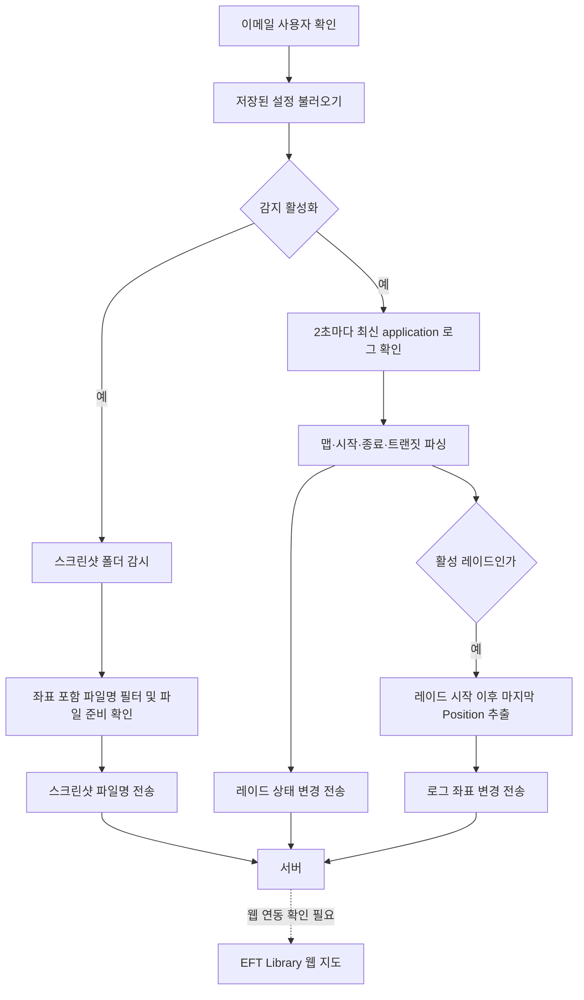

# 내 위치 찾기 기능 현황과 확장·디자인 개편 계획

작성 기준: 2026-10-08, 이 저장소의 현재 소스와 미커밋 변경사항.

이 문서는 기능을 추가하고 UI를 개편할 때 참고할 개발 기준 문서다. 현재 구현, 확인되지 않은 동작, 향후 제안을 구분한다. 실제 EFT 로그나 서버 구현을 확인한 결과는 아니며, 코드가 있다는 이유만으로 게임·서버·웹 지도 연동까지 완료된 것으로 보지 않는다.

## 1. 목표와 현재 단계

프로그램은 Windows에서 실행되는 EFT Library 연동 도구다. 사용자 이메일을 확인하고, 게임 스크린샷 파일명과 application 로그를 읽어 위치 및 레이드 상태를 서버로 전달한다. 게임 파일을 수정하지 않는다.

기존 스크린샷 전송 흐름에 로그 기반 레이드 감지와 좌표 전송이 더해져 있다. 다음 개발에서는 사용자가 **어떤 맵에서 어떤 방식으로 위치를 수집하고 있으며, 서버에 언제 전달했는지** 바로 알 수 있게 만드는 것이 핵심이다.

### 구현 상태

| 기능 | 현재 소스 상태 | 추가 확인 또는 작업 |
| --- | --- | --- |
| 이메일 사용자 확인 | 구현됨 | 서버 오류와 미등록 사용자 UX 구분 |
| 이메일 저장 | 구현됨 | 계정 변경 흐름 설계 |
| 스크린샷 자동 경로 탐색·수동 지정 | 구현됨 | 다양한 설치 환경 확인 |
| 스크린샷 파일명 전송 | 구현됨 | 실제 파일명·웹 지도 반영 확인 |
| 로그 자동 경로 탐색·수동 지정 | 구현됨 | BSG·Steam 설치 환경별 확인 |
| 맵·레이드 시작/종료·트랜짓 감지 | 구현됨 | 실제 로그 형식별 정확도 확인 |
| 로그 XYZ 좌표 추출·전송 | 미커밋 코드에 구현됨 | 실제 좌표 로그 존재 여부, 서버 계약, 지도 반영 확인 |
| 스크린샷·로그 감지 일괄 시작/중지 | 구현됨 | 처리 중인 작업의 중지 정책 보완 |
| 트레이 최소화·열기·종료 | 구현됨 | 개편 화면과 상태 표시 연계 |
| 이벤트 이력·전송 재시도·위치 우선순위 | 미구현 | 확장 설계 필요 |
| 디자인 개편 | 이 문서의 제안 | 화면·데이터 모델 구현 필요 |

정확한 완료율을 산정할 작업 목록은 없다. 현재는 클라이언트 코드 구현 후 통합 검증이 남아 있는 단계다. 실행 파일이 현재 소스와 일치하는지도 별도로 확인해야 한다.

## 2. 전체 데이터 흐름



클라이언트의 지도 버튼은 외부 브라우저를 연다. 현재 WPF 화면에 지도 렌더링이나 예상 잔여 시간 계산 기능은 없다. README에 언급된 자동 맵 전환·예상 잔여 시간·트랜짓 안내는 서버 및 웹에서의 동작을 확인해야 한다.

## 3. 기존 스크린샷 기능 상세

### 3.1 사용자 확인

- `UserService`가 이메일을 `/api/where-am-i/check-wpf-user`에 POST한다.
- HTTP 성공과 JSON의 `data: true`를 확인한다.
- 사용자 확인 후 감시 화면으로 이동한다.
- 이메일 저장 설정에 따라 로컬 이메일을 저장하거나 제거한다.
- 이메일 확인은 현재 계정 연결 수단이다. 인증 토큰을 사용하는 로그인과 동일한 것으로 간주하지 않는다.

### 3.2 폴더 탐색과 감시

`ScreenshotPathService`가 Windows 문서·사진 폴더, OneDrive 문서, Steam 관련 경로 및 저장된 사용자 지정 경로를 탐색한다. 실제 존재하는 경로에 `FileSystemWatcher`를 연결한다.

- 하위 폴더는 감시하지 않는다.
- 새 파일의 `Created` 이벤트를 처리한다.
- 경로는 15초마다 다시 탐색한다.
- 사라진 폴더의 감시를 해제한다.
- 감시 오류 시 해당 감시기를 제거하고 이후 경로 탐색에서 재연결을 시도한다.
- 화면 목록에는 현재 감시 중인 스크린샷 경로가 표시된다.

### 3.3 파일 필터와 전송

파일명에 세 개의 숫자 좌표가 쉼표로 들어 있고 PNG/JPG/JPEG 확장자를 가지는 패턴을 검사한다. 음수와 소수를 허용한다. 이미지 내용을 분석해 좌표를 얻는 방식은 아니다.

동일 전체 경로의 이벤트를 3초 이내 중복 처리하지 않는다. 파일이 읽기 가능하고 크기가 0보다 큰지 최대 20회 확인하며, 읽기 오류나 접근 오류가 있으면 회당 200ms 기다린다. 파일 저장 완료를 완벽하게 보장하는 판정은 아니다.

전송 데이터는 이메일과 파일명이다. 이미지 바이너리는 업로드하지 않는다. 서버의 HTTP 성공 여부와 응답의 `data: true`를 검사한 뒤 최근 전송 메시지를 표시한다.

## 4. 로그 기능 상세

### 4.1 로그 경로 탐색

`TarkovLogPathService`가 다음 후보를 만든다.

1. 사용자가 마지막으로 지정한 로그 폴더.
2. `%LocalAppData%\Battlestate Games\EscapeFromTarkov\Logs`.
3. Windows 설치 레지스트리의 `InstallLocation` 아래 `Logs`.
4. 같은 설치 위치 아래 `build\Logs`.

현재 로그 경로 탐색에는 스크린샷 서비스와 같은 Steam 라이브러리 직접 탐색 로직이 없다. Steam 환경에서 레지스트리 후보로 충분한지 확인하고, 필요하면 탐색을 확장한다.

사용자가 지정한 경로는 단일 경로로 저장된다. 경로 지정은 자동 탐색 후보를 제거하지 않으며, 지정한 폴더가 반드시 최종 선택되는 것도 아니다.

### 4.2 읽을 파일 선택과 주기

`TarkovLogMonitor`는 시작 즉시 한 번 실행하고 이후 2초 간격으로 확인한다.

- 후보 폴더의 하위 디렉터리까지 `*.log`를 탐색한다.
- 파일명에 `application`이 포함된 파일을 대소문자 구분 없이 선택 대상으로 삼는다.
- 모든 후보 중 최종 수정 시각이 가장 최근인 파일 하나를 읽는다.
- 전체 경로·파일 크기·최종 수정 시각 조합이 이전과 같으면 파싱을 생략한다.
- 동시에 여러 폴링이 겹치지 않도록 `SemaphoreSlim`을 사용한다.
- 파일은 다른 프로세스의 쓰기 및 삭제를 허용하는 공유 모드로 연다.
- 파일 끝에서 최대 500,000바이트 구간을 읽는다. 500,000문자가 아니다.

최근 변경으로 기존 `application_*.log` 제한을 넓혔다. 날짜로 시작하고 `application.log`로 끝나는 형식도 후보가 될 수 있다. 다만 현재 조건은 이 두 형식을 정확히 열거하는 것이 아니라 `application`을 포함하는 모든 `.log` 파일이다.

### 4.3 맵 판별

다음 패턴 종류를 순서대로 검사한다.

1. `rcid:...scenespreset`
2. `maps/...bundle`
3. `Locations: ...`
4. `Location: ...,`

각 종류의 마지막 매치를 사용하고, 알려진 별칭으로 변환할 수 있는 첫 종류의 결과를 반환한다. 모든 종류를 합쳐 시간상 가장 최근 맵을 고르는 방식은 아니다. `_preset` 문자열은 제거한다.

| 로그의 맵 별칭 | 서버로 보내는 맵 값 |
| --- | --- |
| `bigmap` | `customs` |
| `factory4_day`, `factory4_night`, `factory_day`, `factory_night` | `factory` |
| `interchange`, `shopping_mall` | `interchange` |
| `laboratory` | `the-lab` |
| `labyrinth` | `the-labyrinth` |
| `lighthouse` | `lighthouse` |
| `rezervbase` | `reserve` |
| `shoreline` | `shoreline` |
| `tarkovstreets`, `tarkov streets` | `streets-of-tarkov` |
| `terminal` | `terminal` |
| `woods` | `woods` |
| `sandbox`, `sandbox_high`, `sandbox_start`, `sandbox_sl` | `ground-zero` |

별칭 표에 없는 값은 맵 미확인으로 처리한다. 이 표는 현재 코드의 매핑이며 실제 게임의 모든 로그 형식을 지원한다는 보장은 아니다.

### 4.4 레이드와 트랜짓 판별

- `GameStarted`가 포함된 마지막 유효 시각을 시작 시각으로 사용한다.
- `PrepareSelectedProfileLocally`가 포함된 마지막 유효 시각을 종료 판단에 사용한다.
- 시작 시각이 있고 종료 시각이 없거나 종료 시각이 시작보다 이전이면 활성 레이드로 판단한다.
- `[Transit]` 행의 `Count:` 값을 순회해 마지막 값을 사용한다. 없으면 0이다.
- `RaidState`의 맵·시작 시각·활성 여부·트랜짓 횟수 중 하나라도 바뀌면 이벤트가 발생한다.

종료 원인, 탈출 성공, 사망, PMC/Scav 구분은 현재 모델에 없다. 트랜짓 횟수는 읽은 구간의 마지막 값이며 현재 레이드에 속하는지 별도로 검증하지 않는다.

### 4.5 로그 위치 추출: 이번 추가 코드

새 `LogLocation` 모델은 `X`, `Y`, `Z`, `ObservedAt`을 보관한다.

파서가 찾는 형태의 설명용 예시는 다음과 같다. 실제 게임에서 확보한 샘플은 아니다.

```text
2026-10-08 21:15:30.123 ... Position:(123.4, 5.6, -78.9)
```

- 행 시작에 날짜·시각이 있어야 한다.
- `Position:(...)`의 대소문자와 구두점이 현재 정규식과 일치해야 한다.
- 좌표는 음수와 소수를 허용하며 지수 표기나 `+` 접두사는 지원하지 않는다.
- 정규식은 소수 초 자릿수를 여러 개 허용하지만, 시각 파싱은 `fff` 형식이다. 세 자리 이외의 소수 초는 검증이 필요하다.
- 시각은 실행 PC의 로컬 시간으로 해석한다.
- 레이드 시작 시각보다 이전인 위치는 제외한다.
- 매칭된 순서에서 마지막 유효 위치를 반환한다. 시각으로 별도 정렬하지 않는다.
- 활성 레이드로 판단했을 때만 위치를 추출한다.
- 직전 위치와 레코드가 다르면 이벤트를 발생시킨다. 좌표가 같아도 관측 시각이 다르면 새 위치로 취급한다.

이 기능은 게임이 `Position` 정보를 기록할 때만 위치를 얻을 수 있다. 로그 감지 주기가 2초라는 이유로 게임 좌표도 2초마다 생성되거나 연속 추적된다고 안내하면 안 된다.

## 5. 서버 전송 계약: 클라이언트 기준

기본 주소: `https://back.eftlibrary.com`. 아래 표는 현재 클라이언트가 보내는 요청이다. 서버가 해당 계약을 구현했는지는 이 저장소에서 확인할 수 없다.

| 목적 | POST 경로 | 필드 | 클라이언트 성공 판정 |
| --- | --- | --- | --- |
| 사용자 확인 | `/api/where-am-i/check-wpf-user` | `email` | HTTP 성공 + `data: true` |
| 스크린샷 위치 | `/api/where-am-i/send-location` | `email`, `location` | HTTP 성공 + `data: true` |
| 레이드 상태 | `/api/where-am-i/v3/send-raid-state` | `email`, `map`, `started_at`, `is_active`, `transit_count` | HTTP 성공 |
| 로그 위치 | `/api/where-am-i/v3/send-log-location` | `email`, `map`, `x`, `y`, `z`, `observed_at` | HTTP 성공 |

좌표·레이드 요청은 감시 화면의 공용 `HttpClient`를 사용하며 제한 시간은 15초다. 사용자 확인 서비스는 별도의 클라이언트를 사용한다.

### 로그 위치 요청 예시

```json
{
  "email": "player@example.com",
  "map": "customs",
  "x": 123.4,
  "y": 5.6,
  "z": -78.9,
  "observed_at": "2026-10-08T21:15:30.123+09:00"
}
```

### 레이드 상태 요청 예시

```json
{
  "email": "player@example.com",
  "map": "customs",
  "started_at": "2026-10-08T21:10:00+09:00",
  "is_active": true,
  "transit_count": 0
}
```

맵 또는 시작 시각은 파싱 결과에 따라 `null`일 수 있다. 로그 위치의 맵은 활성 레이드 상태 이벤트에서 저장한 값을 사용한다. X/Y/Z의 지도 변환 방식과 Y를 이용한 층 판별은 서버·웹과 합의해야 한다.

레이드 이벤트를 먼저 발생시키지만 요청 완료를 기다리고 위치 요청을 보내지는 않는다. 서버에는 위치 요청이 먼저 도착할 수 있다. 현재 요청에는 세션 ID나 순서 번호가 없다.

### 5.1 향후 로그 이벤트 전송: BTR 정차 정보 등

사용자 요청에 따라, 로그에 BTR 정차 관련 정보가 존재하면 추출하여 확인할 수 있도록 전송 계약을 확장한다. 아직 실제 로그를 확보하지 않았으므로 BTR 이벤트의 존재 여부와 형식, 정차 시간의 의미는 미확정이다. 현재 클라이언트에는 BTR 파서나 전송 기능이 없다.

우선 확인할 후보 정보는 다음과 같다.

| 후보 정보 | 실제 로그에서 확인할 조건 |
| --- | --- |
| BTR 정차 지점 | 지점 이름 또는 식별자가 기록되는지 |
| 정차 시작 시각 | 도착·정차 이벤트와 시각이 있는지 |
| 출발 시각 | 출발·이동 재개 이벤트가 있는지 |
| 실제 정차 시간 | 같은 차량·지점·회차의 정차 시작과 출발을 연결할 수 있는지 |
| 예정 정차 시간 | 로그가 명시적으로 예정 시간과 단위를 제공하는지 |
| 다음 정차 지점 | 목적지 또는 경로 이벤트가 있는지 |

“BTR stop 시간”은 정차한 시각, 실제 머문 시간, 예정 대기 시간을 구분해야 한다. 출발 행이 없으면 실제 정차 시간을 확정하지 않는다. 로그 기록 시각을 실제 발생 시각으로 간주해도 되는지도 샘플에서 확인한다. 로그에 없는 정보는 추정값을 확정값처럼 전달하지 않는다.

#### 전송 구조 제안

레이드 상태나 위치 요청에 BTR 전용 필드를 계속 붙이기보다, 별도 게임 로그 이벤트 계약을 검토한다. API 경로는 백엔드 구현을 확인한 뒤 확정한다. 기존 위치·레이드 API는 현재 목적을 유지한다.

후보 공통 필드:

- `event_id`: 재시도 및 중복 전송을 구분할 식별자.
- `session_id`: 이벤트가 속하는 레이드 세션 식별자.
- `map`: 확인된 맵, 미확인 처리 정책 필요.
- `event_type`: 예를 들어 BTR 정차 시작/출발 등 합의된 종류.
- `observed_at`: 로그에서 확인한 관측 시각, 시간대 포함.
- `source`: application 로그 등 입력 출처.
- `payload`: 이벤트별 정차 지점·차량 식별자·기간 및 단위.

공통 계약에서 사용자 식별·인증 방법은 기존 백엔드 방식과 맞춘다. 위 필드명은 제안이며 기존 서버 모델에 맞춰 변경할 수 있다. 실제 로그 샘플 확보 전에는 특정 이벤트 이름이나 시간 필드가 존재한다고 가정하지 않는다.

#### 서버와 화면 역할

1. 클라이언트는 실제 로그에서 확인 가능한 이벤트를 추출한다.
2. 서버는 세션·맵·이벤트 시각을 검증하고 중복 및 늦게 도착한 이벤트를 처리한다.
3. 시작과 출발로 정차 시간을 계산한다면 클라이언트·서버 중 계산 책임을 하나로 정한다.
4. 화면에는 확인된 정차 지점·시각·기간과 마지막 갱신 시각을 표시한다.
5. 값이 없거나 연결할 이벤트가 부족하면 “정차 시간 확인 불가” 또는 “출발 기록 대기”로 표시한다.

BTR 외에도 실제 로그에 의미 있는 이벤트가 있다면 같은 구조로 확장할 수 있다. 추가 이벤트마다 로그 근거, 시간 의미와 단위, 세션 연결 방식, 서버 계약, 표시 문구를 문서화한다.

완료 기준: 실제 BTR 로그 샘플로 추출 항목을 확정하고, 중복·시작 누락·출발 누락·트랜짓 상황에서도 확인된 값과 미확인 값을 구분해 서버와 화면에서 처리한다.

### 5.2 백엔드에서 확인할 도메인과 API 계약

현재 문서의 기본 주소 `https://back.eftlibrary.com`은 클라이언트에 하드코딩된 값이다. 백엔드 소스와 배포 설정을 확인한 결과는 아니다.

- **라우트/컨트롤러/스키마:** 실제 API 경로, HTTP 메서드, 요청·응답 필드, 인증 방식, 오류 코드를 확인한다.
- **환경 설정:** 개발·운영 API 기본 주소와 환경별 차이를 확인한다. 설정 키와 필요한 값만 확인하며 비밀값을 문서에 복사하지 않는다.
- **배포·프록시·게이트웨이 설정:** 외부 공개 도메인, 경로 접두사, HTTPS 및 내부 서비스 연결을 확인한다.
- **OpenAPI 문서가 있다면:** 라우트와 데이터 계약의 참고 자료로 사용하고 실제 배포 설정과 함께 대조한다.

백엔드 기능 코드만으로 공개 도메인을 알 수 없는 경우가 있다. 공개 도메인은 배포 환경이나 프록시에서 정해질 수 있으므로 **기능 코드로 계약을 확인하고, 배포 설정으로 주소를 확인**한다.

백엔드 저장소를 확인할 수 있게 되면 사용자 확인·위치·레이드 API, 맵 별칭 API, 버전 확인 API, 추가 로그 이벤트 API의 도메인 및 계약을 함께 검토한다. 현재 문서의 API 후보를 실제 운영 계약으로 확정하는 작업은 그 이후 진행한다.

## 6. 제어와 로컬 저장

감지 시작/중지는 스크린샷 감시와 로그 감시를 함께 제어한다. 중지하면 스크린샷 감시기를 제거하고 경로 갱신 및 로그 타이머를 멈춘다. 이미 시작한 HTTP 요청이나 폴링을 취소하는 기능은 없다.

설정 위치는 `%LocalAppData%\EFTLibrary\WhereAmI`다.

| 파일 | 내용 |
| --- | --- |
| `settings.json` | 버전 2, 이메일 저장 여부·이메일, 감지 활성 여부, 첫 안내 표시 여부 |
| `screenshot-path.txt` | 사용자 지정 스크린샷 경로 |
| `log-path.txt` | 사용자 지정 로그 경로 |

설정 파일 읽기 실패 시 기본 설정을 사용하는 처리가 있다. 이메일은 JSON에 평문 저장된다. 사용자 지정 경로는 각 파일에 하나씩 저장하며, 여러 사용자 지정 경로를 관리하는 UI는 없다.

## 7. 현재 UI와 한계

### 현재 구성

- 사용자 확인 창: 460×470.
- 감시 창: 660×680, 최소화 가능하며 사용자의 창 크기 조절은 제한된다.
- 어두운 배경, 회색 카드, 주황색 주요 버튼, 빨간색 종료 버튼.
- 로고 → 스크린샷 감시 제목 → 레이드/로그 상태와 일괄 감지 버튼 → 스크린샷 경로와 최근 메시지 → 하단 버튼 4개.
- 하단 버튼: 감시 폴더 선택, 로그 폴더 선택, 지도 바로가기, 프로그램 종료.
- 지도 바로가기는 현재 맵과 무관하게 `/live-map/customs`를 연다.

### 기능 확장 시 문제가 되는 부분

1. 화면 제목이 스크린샷 감시에 머물러 있어 로그 좌표 기능을 설명하지 못한다.
2. 초록색 상태 점은 고정 색상이라 중지·오류 상태를 정확히 나타내지 않는다.
3. `LastActivity` 하나에 좌표 전송·경로 등록·통신 오류가 함께 기록되어 메시지가 덮어써진다.
4. 로그 파일, 최신 관측 시각, 좌표 출처, 마지막 서버 전달 시각이 독립적으로 보이지 않는다.
5. 로그를 읽는 상태와 실제 위치를 얻는 상태, 서버 전달 상태를 구분하기 어렵다.
6. 경로 목록이 중심이라 현재 레이드 정보를 보려면 여러 메시지를 해석해야 한다.
7. 고정 창 크기와 하단 네 버튼은 기능 증가·긴 한글 문구·고배율 화면에 불리하다.
8. 로고는 원격 URL에서 불러온다. 오프라인 표시와 로컬 자산 사용을 검토해야 한다.

## 8. 알려진 동작 한계와 개선 후보

| 항목 | 현재 동작 또는 위험 | 개선 방향 |
| --- | --- | --- |
| 오래 진행한 레이드 | 시작 행이 마지막 500,000바이트 밖으로 밀리면 비활성으로 판단할 수 있음 | 파일별 읽기 위치와 세션 상태 유지 |
| 오래된 로그 선택 | 최근 수정 파일을 읽을 뿐 현재 게임 세션인지 확인하지 않음 | 로그 세션·신선도·사용자 지정 우선순위 정책 |
| 트랜짓 맵 판별 | 패턴 종류 우선순위 때문에 더 오래된 맵이 선택될 수 있음 | 위치·시각 기반 이벤트 순서 해석 |
| 위치 신선도 | 시작 이후 위치라도 오래된 좌표를 보낼 수 있음 | 관측 경과 시간과 오래됨 상태 표시 |
| 전송 실패 | 직전 감지값은 이미 저장되어 같은 값 자동 재시도 없음 | 감지 상태와 전달 완료 상태 분리 |
| 파일 읽기 실패 | 읽기 전 signature 저장으로 변경 없는 파일은 다음 폴링에서 생략 가능 | 읽기 성공 후 signature 확정 |
| 여러 입력의 경쟁 | 스크린샷과 로그가 각각 독립 전송 | 출처·시각·우선순위를 가진 공통 위치 모델 |
| 요청 순서 | 여러 비동기 전송이 겹칠 수 있음 | 큐·세션 ID·순서 번호·서버 중복 방지 |
| 중지·종료 | 진행 중 작업 취소와 종료 동기화가 제한적 | 취소 토큰 및 안전한 작업 종료 |
| 타임스탬프 | 로컬 시각·밀리초 형식에 의존 | 실제 샘플 기반 형식 지원과 시간대 계약 |
| 성공 표시 | 로그 API는 본문 의미를 확인하지 않음 | 공통 응답 계약 및 오류 코드 |

이 항목들은 코드 검토에서 도출한 개선 후보다. 실제 장애가 재현된 목록과는 구분한다.

## 9. 기능 확장 제안

아래 내용은 아직 구현되지 않은 제안이다. 기능 추가 전에 서버·웹 변경 범위를 함께 확정한다.

### 9.1 감지 상태와 연결 상태 분리 — 우선순위 P0

다음 정보를 독립 상태로 보관하고 화면에 표시한다.

- 감지 설정: 활성/중지.
- 스크린샷: 경로 미설정/감시 중/접근 오류.
- 로그: 파일 없음/감시 중/읽기 오류.
- 레이드: 미확인/대기/진행/트랜짓 감지.
- 위치: 없음/최신/오래됨, 출처, 관측 시각.
- 전송: 대기/전송 중/성공/실패, 마지막 성공 시각.

로그 파일을 정상적으로 읽었지만 좌표 행이 없으면 “로그 감지 중 · 위치 기록 대기”처럼 안내한다. 서버 연결됨 표시는 실제 요청 성공 또는 별도 상태 확인에 근거해야 한다.

완료 기준: 폴더 없음, 감지 중지, 좌표 없음, 전송 실패를 서로 다른 상태와 안내로 표현한다.

### 9.2 공통 위치 모델과 출처 정책 — P0

후보 모델: `PositionObservation(Map, X, Y, Z, ObservedAt, Source, SessionId)`.

- `Source`는 screenshot/log 등으로 구분한다.
- 좌표 관측 시각과 서버 전달 시각을 분리한다.
- 최신 관측을 우선하는 정책을 기본 후보로 삼되, 스크린샷 시각의 신뢰도를 먼저 확인한다.
- 맵이 불명확할 때 전송 보류 또는 서버 판별 중 어느 정책을 쓸지 결정한다.
- 오래된 위치의 경고 임계값은 실제 로그 발생 간격을 확인한 뒤 정한다.
- Y를 활용한 층 표시는 지도별 층 기준 데이터가 있어야 제공한다.

완료 기준: 두 출처가 동시에 들어와도 오래된 좌표가 최신 좌표를 덮어쓰지 않으며, 사용자가 출처와 시각을 볼 수 있다.

### 9.3 전송 큐와 재시도 — P0

- HTTP 처리를 ViewModel에서 전송 서비스로 옮긴다.
- 성공한 전달값과 마지막으로 감지한 값을 별도로 관리한다.
- 일시 오류만 제한적으로 재시도하고, 사용자 확인 실패·유효하지 않은 요청은 명확히 안내한다.
- 위치 큐는 오래된 좌표를 계속 쌓기보다 최신 위치를 유지하는 정책을 검토한다.
- 레이드 시작/종료 이벤트는 위치와 달리 보존 순서가 중요하다.
- 중지 시 신규 수집과 재시도 중지 여부, 진행 중 요청 취소 정책을 정한다.
- 서버 변경 시 세션 ID·순서 번호·중복 방지 키를 함께 설계한다.

완료 기준: 일시적인 연결 실패 이후 최신 위치가 복구되며, 이전 레이드 데이터가 새 레이드를 덮어쓰지 않는다.

### 9.4 진단과 활동 이력 — P1

최근 이벤트를 시간·종류·내용·결과로 보관한다. 예: 로그 발견, 레이드 시작, 맵 변경, 위치 감지, 전송 실패, 감지 중지.

- 사용자가 이력 필터와 진단 정보 복사를 사용할 수 있게 한다.
- 기본 보관 개수와 기간을 정해 무제한 누적을 막는다.
- 진단 복사에는 이메일과 Windows 사용자 경로를 기본 마스킹한다.
- 원본 게임 로그 전체 업로드와 진단 요약 복사는 별도 기능으로 다룬다.

완료 기준: 마지막 메시지가 다른 이벤트로 덮여도 이전 실패 원인과 시각을 찾을 수 있다.

### 9.5 경로 및 설정 관리 — P1

- 탐색된 경로, 사용자 지정 경로, 실제 선택된 로그 파일을 구분한다.
- 경로 선택·폴더 열기·재검색·사용자 지정 경로 초기화를 제공한다.
- 스크린샷과 로그의 개별 활성화를 추가할지 결정한다.
- 여러 사용자 지정 경로가 필요하면 단일 txt 파일 구조를 설정 목록으로 이관한다.
- 계정 변경, 시작 시 트레이 실행, Windows 시작 시 실행은 별도 선택 설정으로 검토한다.

완료 기준: 사용자가 현재 어떤 파일을 읽는지 확인하고 자동 탐색 실패를 화면에서 해결할 수 있다.

#### 사용자 지정 감시 경로 DB 수집 — 사용자 확정 방향 (2026-10-17)

사용자가 직접 선택한 감시 폴더 경로를 백엔드로 전송하여 DB에 기록한다. 목적은 **사용자 환경의 경로 패턴을 분석하고 자동 경로 탐색을 개선하기 위한 로그 수집**이다. 사용자가 DB 테이블 `where_am_i_path_reports`를 생성했다고 공유했다. 클라이언트 전송과 서버 API의 구현·연동 여부는 별도 확인이 필요하다.

수집 대상은 다음 두 종류다.

| 경로 종류 | 수집 값 | 분석 목적 |
| --- | --- | --- |
| 스크린샷 감시 폴더 | 사용자가 직접 지정한 스크린샷 폴더 경로 | 기본 탐색으로 찾지 못하는 저장 위치와 경로 패턴 파악 |
| 로그 감시 폴더 | 사용자가 직접 지정한 로그 폴더 경로 | 설치 방식·설치 위치에 따른 Logs 경로 패턴 파악 |

**서버 DB는 프로그램 설정 복원용으로 사용하지 않는다.** 프로그램 실행 시 DB에서 이 경로를 다시 가져오거나 감시 경로로 적용하지 않는다. 기존 로컬 `screenshot-path.txt`, `log-path.txt` 저장과 불러오기 흐름은 계속 사용한다. 자동 탐색 후보 전체나 사진·게임 로그 파일 내용은 이 수집 기능의 대상이 아니다.

권장 처리 흐름:

1. 사용자가 스크린샷 또는 로그 폴더를 직접 선택한다.
2. 클라이언트가 경로를 정규화하고 로컬 저장을 완료한다.
3. 기존 방식대로 감시 경로를 적용하거나 로그 재탐색을 요청한다.
4. 경로 종류와 지정 경로를 별도 수집 API로 비동기 전송한다.
5. 서버가 수집 시각과 함께 DB에 기록하여 패턴 분석에 사용한다.

경로 수집의 성공 여부는 실제 스크린샷 감지·로그 감지·위치 전송 성공과 별도로 관리한다. 수집 API가 실패하더라도 로컬 경로 저장과 감시 기능은 계속 동작하게 한다. 앱 시작 때 수집 완료한 기존 경로를 반복 전송하지 않는다. 다만 업데이트 전부터 사용하던 경로는 아래 최초 수집 절차로 전송한다.

기존 사용자 경로 최초 수집:

1. 수집 기능이 포함된 버전으로 업데이트한 사용자가 사용자 확인에 성공하면 기존 로컬 사용자 지정 경로를 읽는다.
2. 스크린샷·로그 경로 중 값이 있고 아직 수집 완료되지 않은 항목만 비동기로 전송한다. 사용자가 폴더를 다시 선택할 필요는 없다.
3. 서버가 저장 성공을 확인한 항목만 로컬에 수집 완료 상태를 기록한다. HTTP 응답뿐 아니라 합의된 성공 응답을 확인한다.
4. 실패한 항목은 완료로 표시하지 않고 다음 실행의 사용자 확인 성공 후 재시도한다. 한 경로의 성공이나 실패가 다른 종류의 수집 상태를 덮어쓰지 않는다.
5. 이후 사용자가 경로를 변경하면 새 경로 선택 흐름으로 전송한다. 실패한 새 경로도 다음 실행 시 재시도 대상에 포함한다.

수집 완료 상태는 경로 종류와 정규화된 경로를 기준으로 구분한다. 프로그램 버전이 바뀌었다는 이유만으로 같은 경로를 다시 최초 수집하지 않는다. 경로 변경 중 이전 요청이 완료되어도 새 경로를 수집 완료로 잘못 표시하지 않도록 요청 당시 경로를 기준으로 상태를 갱신한다.

기존 로컬 경로가 비어 있으면 해당 종류는 건너뛰며, 자동 탐색으로 발견한 후보를 대신 수집하지 않는다. 최초 수집은 서버에서 설정을 다운로드하는 작업이 아니며, 실행 시 경로 복원은 계속 로컬 설정을 사용한다. 구버전 프로그램에는 수집 기능이 없으므로 업데이트한 사용자부터 수집할 수 있다.

수집 출처 구분이 필요해지면 `collection_source`를 추가하여 `existing_settings`(기존 설정 최초 수집)와 `user_selection`(사용자의 새 경로 선택)을 구분할 수 있다. 이는 현재 테이블 기준 필수 구현 범위에 포함하지 않는다. 응답 유실 후 재시도로 같은 경로가 중복 저장되어도 허용한다. 분석용 로그이므로 서버 중복 방지 키나 고유 제약은 추가하지 않는다.

실제 생성된 테이블 — `where_am_i_path_reports`:

```sql
create table if not exists where_am_i_path_reports (
    id bigint generated by default as identity primary key,
    path_type varchar(16) not null,
    path text not null,
    app_version varchar(64) not null,
    created_at timestamptz not null default now(),
    constraint ck_path_reports_type
        check (path_type in ('screenshot', 'log')),
    constraint ck_path_reports_path
        check (char_length(btrim(path)) > 0 and char_length(path) <= 4096),
    constraint ck_path_reports_version
        check (char_length(btrim(app_version)) > 0 and char_length(app_version) <= 64)
);
```

| 컬럼 | 현재 계약 |
| --- | --- |
| `id` | DB가 생성하는 bigint 기본 키 |
| `path_type` | 필수, `screenshot` 또는 `log` |
| `path` | 필수, 공백만 있는 값 금지, 최대 4096자 |
| `app_version` | 필수, 공백만 있는 값 금지, 최대 64자 |
| `created_at` | DB 기본값 `now()`로 기록하는 수집 시각 |

API 요청의 기본 필드는 `path_type`, `path`, `app_version`으로 맞춘다. `id`와 `created_at`은 클라이언트가 지정하지 않는다. API에서도 같은 필수값·종류·길이 조건을 검증하여 DB 제약 오류 이전에 잘못된 요청을 안내한다. `btrim` 제약은 공백만 있는 값의 저장을 막지만 저장 문자열을 자동으로 정리하지는 않는다.

두 경로 종류를 하나의 테이블에서 구분한다. 사용자가 한 종류만 지정해도 해당 경로만 독립적으로 기록한다. API 경로와 응답 계약은 백엔드 구현 확인 후 확정한다.

분석용 로그이므로 **동일 경로의 중복 저장을 허용한다**. 현재 테이블을 유지하며 중복 방지용 요청 식별자·고유 제약·서버 중복 제거는 요구하지 않는다. 응답 유실 후 재시도로 중복 행이 생겨도 정상 수집으로 취급한다. 앱의 로컬 수집 완료 기록은 실행할 때마다 불필요하게 반복 전송하는 것을 줄이는 용도로 유지한다.

앞서 제안한 `collection_source`는 현재 테이블에 없으므로 기본 API 요청의 필수 필드로 요구하지 않는다. 기존 설정과 새 선택을 DB에서 구분하는 기능은 선택적인 후속 확장으로 둔다.

경로에는 Windows 사용자 이름 등 개인 식별 정보가 포함될 수 있다. 분석에 필요한 드라이브·폴더 구조를 유지하면서 사용자 이름 부분을 치환하는 방식을 검토하고, 원본 경로와 마스킹 경로 중 실제 저장 범위를 구현 전에 정한다. 이메일 등 사용자 연결 정보가 필요한지, 반복 지정 경로의 중복 처리와 보관 기간도 함께 정한다.

완료 기준:

- 두 종류의 사용자 지정 경로가 구분되어 DB에 수집된다.
- 기존 사용자는 업데이트 후 사용자 확인에 성공하면 저장된 경로가 최초 수집된다.
- 성공한 경로는 반복 수집하지 않고 실패한 항목만 재시도하며, 경로 변경은 별도 수집한다.
- 앱을 다시 실행할 때 서버 경로 조회 없이 기존 로컬 설정으로 감시한다.
- 수집 서버 장애가 로컬 설정·감시 기능을 막지 않는다.
- 수집 데이터로 실제 사용자 지정 경로 패턴을 분석할 수 있다.

### 9.6 맵과 레이드 편의 기능 — P1/P2

- 지도 바로가기를 확인된 현재 맵으로 연결하고, 미확인일 때 기본 맵 정책을 적용한다.
- 레이드 경과 시간은 시작 시각을 기준으로 계산할 수 있다.
- 예상 잔여 시간은 맵·게임 모드·레이드 조건별 기준이 확보된 뒤 제공하며 “예상”으로 표시한다.
- 수동 맵 지정이 필요하면 자동 감지와 수동 선택 중 우선순위를 명시한다.
- 앱 내 지도는 외부 브라우저 방식보다 개발 범위가 크다. 인증·지도 자산·좌표 변환·웹 재사용 여부를 확인하고 별도 단계로 결정한다.

### 9.7 로그 맵 별칭 DB 연동 — 사용자 확정 방향

현재 클라이언트에 하드코딩된 `MapAliases`를 향후 DB 관리 구조와 연결한다. DB 테이블 및 API는 아직 구현되지 않았으며 아래 항목은 설계 제안이다.

권장 흐름은 **DB → 서버 API → 클라이언트의 별칭 목록 캐시 → 로그 파싱**이다. 실행 파일이 DB에 직접 연결하거나 로그 행마다 서버에 조회하지 않는다. 이 방식은 게임 맵 이름이 추가되거나 바뀌었을 때 별칭 수정만으로 대응하기 쉽다.

| 별칭 테이블 후보 필드 | 용도 |
| --- | --- |
| `id` | 별칭 행 식별자 |
| `alias` | 로그에 등장하는 맵 이름 |
| `map_id` | 기존 맵 테이블의 정식 맵을 가리키는 외래 키 |
| `is_active` | 사용 여부 |
| `updated_at` | 변경 시각 |

- 실제 테이블명과 `map_id` 자료형은 기존 DB 스키마 확인 후 정한다.
- 별칭은 대소문자 정규화 후 중복되지 않도록 관리한다.
- 서버 응답에는 클라이언트와 웹이 공통으로 사용하는 맵 slug를 포함한다.
- 사용자 확인 후 별칭 목록을 가져오고, 목록 버전 또는 ETag로 변경 여부를 확인하는 방식을 검토한다.
- 정상 수신 목록을 로컬에 저장하고, 조회 실패 시 마지막 정상 목록을 사용한다.
- 첫 실행에서 서버와 캐시 모두 사용할 수 없을 때 기본 내장 별칭을 유지할지 결정한다.
- 알 수 없는 별칭은 원본 값과 함께 진단 이력에 남기고 임의 맵으로 치환하지 않는다.
- 현재 `NormalizeMap`의 `_preset` 제거와 패턴별 맵 선택 정책은 별칭 DB 연동과 별개로 유지·검증해야 한다.

완료 기준: DB 별칭을 수정한 뒤 실행 파일을 다시 배포하지 않아도 갱신된 목록으로 맵을 인식하며, 조회 실패 시에도 정해진 대체 동작을 수행한다.

### 9.8 사용자 확인 직후 실행 파일 버전 확인 — 사용자 확정 방향

사용자 확인이 성공한 직후 현재 실행 파일의 버전을 서버에 전달하고 최신 버전 여부를 확인한다. 현재 앱의 이메일 사용자 확인 흐름에 추가할 수 있다. 이 흐름은 인증 토큰 로그인과는 구분하며, 향후 인증 방식이 바뀌면 해당 방식에 맞춰 API 접근을 조정한다.

현재는 버전 확인 테이블·API·화면이 없다. 서버 DB에 배포 버전 테이블 하나를 추가하고, 실행 파일에는 빌드 시 명시적인 제품 버전을 넣는 안을 제안한다.

| 배포 버전 테이블 후보 필드 | 용도 |
| --- | --- |
| `id` | 배포 식별자 |
| `product` | 제품 구분, 예: `where-am-i` |
| `version` | 표시·비교할 제품 버전 |
| `platform` | 운영체제, 예: `windows` |
| `architecture` | 실행 파일 아키텍처, 예: `x64` |
| `channel` | 배포 채널, 초기에는 `stable` |
| `min_supported_version` | 이 배포 정책에서 허용하는 최소 클라이언트 버전 |
| `download_url` | 공식 다운로드 위치 |
| `release_notes` | 변경 내용 |
| `published_at` | 공개 시각 |
| `is_active` | 배포 활성 여부 |

이 필드 구성은 후보이며, 초기에는 단일 제품·플랫폼·채널로 단순화할 수 있다. 최신 배포는 공개된 활성 행에서 버전 규칙으로 결정한다. 문자열 정렬이나 행 ID만으로 최신 버전을 판정하지 않는다. 버전은 숫자 구성 또는 SemVer 등 한 가지 규칙으로 합의하고, 사전 배포 버전도 같은 규칙으로 처리한다.

#### 확인 흐름

1. 실행 파일의 제품 버전을 읽는다. `.csproj`의 `Version` 및 `InformationalVersion` 등 사용 필드와 서버에 전달할 형식을 통일한다.
2. 사용자 이메일 확인이 성공한다.
3. 감시 화면에 진입하면서 버전 확인 API를 비동기로 호출한다.
4. 서버가 제품·플랫폼·아키텍처·채널에 맞는 공개 배포와 비교한다.
5. 최신이면 현재 버전을 설정 또는 앱 정보 영역에 표시한다.
6. 업데이트 가능이면 새 버전과 변경 내용, 다운로드 버튼을 표시한다.
7. 지원 최소 버전보다 낮으면 서버 정책에 따라 필수 업데이트를 안내한다.
8. 통신 실패 시 “버전 확인 실패”로 표시하고 재확인 행동을 제공한다. 실패를 최신 버전으로 표시하지 않는다.

버전 확인 API의 경로와 요청 방식은 아직 미정이다. 응답 계약 후보는 다음과 같다.

```json
{
  "current_version": "3.0.0",
  "latest_version": "3.1.0",
  "min_supported_version": "3.0.0",
  "update_available": true,
  "update_required": false,
  "download_url": "https://example.com/releases/where-am-i-3.1.0.zip",
  "release_notes": "변경 내용 예시"
}
```

버전과 URL은 설명용이며 실제 배포 정보가 아니다. `update_available` 및 `update_required` 판정을 서버에서 반환하면 클라이언트 간 정책을 통일하기 쉽다. 공개 버전 정보만 필요한 API라면 이메일을 추가로 전달할 필요는 없다.

#### 화면과 실패 정책

- 권장 기본안은 선택 업데이트 알림과 다운로드 페이지 열기다. 자동 설치·실행 파일 교체는 별도 기능으로 설계한다.
- 버전 확인은 제한 시간을 가진 별도 작업으로 처리하여 로그인 후 화면을 무기한 막지 않는다.
- 일시적인 조회 실패는 감지를 계속 허용하는 방향을 기본 제안으로 삼는다.
- 필수 업데이트의 감지 차단 여부는 아직 확정되지 않았다. 적용한다면 차단 범위와 기존 서버 API의 지원 정책을 함께 결정한다.
- 버전 조회 응답의 필수 업데이트 여부와 클라이언트의 서버 사용 가능 여부는 서버에서도 일관되게 적용해야 한다.
- 반복 로그인으로 같은 알림이 과도하게 나오지 않도록 버전별 알림 정책을 둔다.
- 설정/앱 정보에 현재 버전, 확인된 최신 버전, 마지막 확인 시각, 다시 확인 버튼을 배치한다.
- 다운로드 URL은 서버가 관리하는 공식 배포 위치를 사용한다.

완료 기준: 사용자 확인 성공 후 최신·선택 업데이트·필수 업데이트·조회 실패 상태를 구분하고, 플랫폼에 맞는 다운로드 링크와 실제 실행 파일 버전을 표시한다.

## 10. 디자인 개편 제안

### 10.1 정보 구조

화면을 대시보드, 설정, 활동 이력으로 나누는 안을 제안한다. 첫 실행 안내는 계정 연결과 경로 확인을 짧은 단계로 보여주고 완료 후 대시보드로 이동한다.

| 영역 | 사용자가 확인할 정보 | 주요 행동 |
| --- | --- | --- |
| 상단 | 앱 이름, 연결 계정, 감지 상태 | 감지 시작/중지, 설정 |
| 레이드 카드 | 현재 맵, 레이드 상태, 시작·경과 시간, 트랜짓 | 현재 맵 열기 |
| 위치 카드 | X/Y/Z, 출처, 관측 시각, 오래됨 여부 | 상세 정보 보기 |
| 연결 카드 | 마지막 전송 결과·시각, 실패 원인 | 재연결 또는 재시도 |
| 수집 카드 | 스크린샷·로그 상태, 경로 확인 요약 | 경로 설정 |
| 최근 활동 | 시간순 이벤트 일부 | 전체 이력 열기 |

### 10.2 대시보드 와이어프레임

```text
┌──────────────────────────────────────────────────────────────┐
│ EFT Library · 내 위치 찾기       감지 중   [감지 중지] [설정] │
│ 연결 계정: p***@example.com                                   │
├───────────────────────────────┬──────────────────────────────┤
│ 현재 레이드                   │ 최근 위치                    │
│ Customs · 레이드 진행 중      │ X 123.4  Y 5.6  Z -78.9      │
│ 시작 21:10 · 경과 05:30        │ 로그 · 21:15:30 관측         │
│ [현재 맵 열기]                │ 21:15:31 서버 전달 완료      │
├───────────────────────────────┴──────────────────────────────┤
│ 수집 상태                                                    │
│ 스크린샷: 감시 중       로그: 감시 중 · 위치 기록 대기         │
│ [경로 및 수집 설정]                                          │
├──────────────────────────────────────────────────────────────┤
│ 최근 활동                                     [전체 보기]    │
│ 21:15:31  위치 전송 성공                                     │
│ 21:10:00  Customs 레이드 시작                                │
└──────────────────────────────────────────────────────────────┘
```

위 수치는 설명용이다. 데이터가 없을 때는 0이나 임의의 맵 대신 “위치 기록 대기”, “맵 확인 중”을 표시한다. 좌표 없음 상태에서는 관련 성공 메시지도 표시하지 않는다.

### 10.3 상태별 표현

| 상황 | 문구 예시 | 다음 행동 |
| --- | --- | --- |
| 첫 실행 | 계정을 연결하고 감지 경로를 확인하세요 | 계정 확인 → 경로 확인 |
| 레이드 대기 | 레이드 시작을 기다리고 있어요 | 감지 유지 |
| 로그 있으나 좌표 없음 | 로그 감지 중 · 위치 기록 대기 | 스크린샷으로 위치 전달 안내 |
| 폴더 없음 | 로그 폴더를 찾지 못했어요 | 로그 폴더 선택 |
| 위치 오래됨 | 마지막 위치가 오래되었어요 · 관측 시각 표시 | 게임 내 스크린샷 안내 |
| 전송 실패 | 위치를 감지했지만 서버에 전달하지 못했어요 | 재시도 상태 또는 오류 상세 |
| 감지 중지 | 감지를 중지했어요 | 감지 시작 |
| 트랜짓 | 트랜짓을 감지했어요 · 다음 맵 확인 중 | 새 맵 감지 후 갱신 |

### 10.4 시각 규칙과 사용성

- 기존 어두운 테마와 주황색 브랜드 강조를 기본 후보로 유지한다.
- 초록은 정상, 주황/황색은 확인 필요, 빨강은 실패, 회색은 중지·대기에 사용한다.
- 모든 상태에 텍스트 또는 아이콘을 붙여 색상만으로 의미를 전달하지 않는다.
- 주요 행동은 감지 제어와 현재 맵 열기로 제한하고, 경로 설정과 종료는 메뉴 또는 보조 영역으로 이동한다.
- 본문은 14~16px, 보조 정보는 12~13px를 후보로 삼아 실제 WPF/DPI 환경에서 검토한다.
- 간격은 8px 배수를 기준으로 정리하고, 기존 브러시와 버튼 스타일을 공통 자원으로 확장한다.
- 창 크기 조절을 허용하고 최소 크기를 정의한다. 좁은 창에서는 카드가 한 열로 내려가게 설계한다.
- 긴 경로는 축약 표시와 전체 경로 확인·복사를 제공한다.
- 키보드 탭 순서, 포커스 표시, 비활성 버튼의 이유, 125%·150%·200% 배율을 검증한다.
- 원격 로고 대신 패키지에 포함된 로컬 자산 사용을 검토한다.

## 11. 구현 구조 제안

현재 `ConfirmedUserViewModel`이 경로 감시, 이벤트 처리, HTTP 전송, 설정, UI 메시지를 함께 담당한다. 확장 시 아래 책임으로 나누는 안을 제안한다.

| 책임 | 후보 구성요소 | 역할 |
| --- | --- | --- |
| 로그 파싱 | `TarkovLogParser` | 텍스트를 구조화된 이벤트로 변환 |
| 로그 읽기 | `TarkovLogMonitor` | 파일 선택·증분 읽기·세션 관리 |
| 스크린샷 수집 | 별도 감시 서비스 | 파일 이벤트와 중복 필터 처리 |
| 위치 통합 | 위치 상태 서비스 | 출처·맵·시각·신선도 결정 |
| 서버 전달 | API 클라이언트/전송 서비스 | 요청·응답·큐·재시도·취소 |
| 활동 기록 | 활동 이력 서비스 | 구조화된 이벤트 보관·진단 복사 |
| 화면 | 대시보드/설정/이력 ViewModel | 상태 바인딩과 사용자 명령 |

개편 화면을 먼저 문자열 메시지에 묶기보다, 필요한 구조화된 상태 모델을 정의한 뒤 바인딩하는 편이 낫다. 소규모 변경부터 진행하고 모든 서비스를 한 번에 재작성할 필요는 없다.

## 12. 권장 작업 순서와 완료 기준

### 단계 A — 현재 기능 검증

- 실제 게임 로그를 개인정보 제거 후 확보한다.
- 시작·종료·트랜짓·맵·좌표 행의 형식을 확인한다.
- 로그 좌표가 언제, 얼마나 자주 기록되는지 확인한다.
- 서버의 v3 API 존재 여부, nullable 필드, 시간대, 성공 응답을 확인한다.
- Windows에서 빌드하고 두 입력의 웹 지도 반영을 확인한다.

완료 기준: 정상 샘플과 미지원 샘플, 실제 API 응답, 수집 가능한 데이터 범위가 기록되어 있다.

### 단계 B — 상태와 전송 안정화

- 세션 상태 유지, 오래된 위치 표시, 출처 정책을 구현한다.
- 감지와 전달 상태를 분리하고 재시도·요청 순서·취소 정책을 적용한다.
- 실제 선택 파일과 수집 상태를 구조화한다.

완료 기준: 오래 진행한 레이드, 일시 네트워크 실패, 트랜짓, 두 입력 경쟁 상황에서 상태가 유지된다.

### 단계 C — 디자인 개편

- 대시보드·설정·이력 화면과 첫 실행 흐름을 구현한다.
- 동적 상태 표시, 현재 맵 바로가기, 창 크기 대응을 적용한다.
- 문구·색상·키보드·DPI를 검증한다.

완료 기준: 사용자가 현재 맵, 최신 위치, 출처, 서버 전달 상태를 대시보드에서 바로 확인한다.

### 단계 D — 배포와 사용자 문서

- Windows Release 빌드 및 실행 파일 배포를 진행한다.
- 기존 설정을 유지하는 업그레이드를 확인한다.
- 실제 변경된 화면으로 사용법 이미지와 `USER_GUIDE.md`를 갱신한다.
- README의 웹 연동 설명을 검증된 동작에 맞춰 수정한다.

완료 기준: 배포 파일과 문서가 같은 버전의 기능을 설명한다.

## 13. 검증 시나리오

| 시나리오 | 확인할 결과 |
| --- | --- |
| 로그와 스크린샷 폴더가 모두 없음 | 경로별 안내, 수동 선택 가능, 앱 유지 |
| 날짜 접두사 application 로그 | 후보 탐색과 파일 선택 확인 |
| 오래된 로그만 존재 | 현재 레이드 오인 여부, 오래됨 처리 정책 확인 |
| 레이드 시작 후 위치 기록 없음 | 위치 대기 표시, 임의 좌표 전송 없음 |
| 이전 레이드 위치 포함 | 시작 이전 좌표 제외 |
| 소수 초 3자리 외 형식 | 지원/거부 결과 기록, 필요한 파서 보완 |
| 로그가 500,000바이트 이상 증가 | 시작 정보 손실 여부 확인 |
| 트랜짓 후 다음 맵 | 맵·세션·트랜짓 값의 연속성 확인 |
| 동일 좌표에 새로운 시각 | 현재 변경 감지 의미 및 전송 빈도 확인 |
| 로그·스크린샷 동시 입력 | 지도 최신성 및 출처 정책 확인 |
| 서버 4xx/5xx·시간 초과 | 실패 표시와 향후 재시도 정책 확인 |
| 감지 중지 직전 이벤트 | 진행 중 요청 처리 정책 확인 |
| 게임 로그 파일 교체·삭제 | 새 파일 감지와 예외 복구 확인 |
| 앱 재시작 | 이메일·경로·감지 설정 복원 |
| 트레이 최소화·열기·종료 | 감지 유지와 자원 정리 |
| 긴 경로·좁은 창·고배율 | 정보 잘림·버튼 겹침·키보드 접근 확인 |

테스트는 실제 로그 형식과 실패 조건을 검증하는 데 초점을 둔다. 문서 작성만으로 이 검증이 수행된 것은 아니다.

## 14. 다음 개발 전에 결정할 사항

1. 로그 좌표가 실제로 생성되는 조건과 주기.
2. 서버 v3 API 및 웹 지도 변경 담당 범위.
3. 자동 위치와 스크린샷 위치의 최신성·우선순위.
4. 로그가 없거나 맵을 모를 때 허용할 동작.
5. 외부 브라우저 지도 유지 또는 앱 내 지도 도입 여부.
6. 일괄 감지 버튼 유지 또는 입력별 제어 추가 여부.
7. 예상 시간·PMC/Scav·사망/탈출 정보의 데이터 근거.
8. 별칭 API 갱신 주기와 캐시·기본 별칭 대체 정책.
9. 버전 비교 규칙, 공식 다운로드 위치, 필수 업데이트 차단 여부.
10. 첫 개편 범위: 안정화 + 대시보드 우선, 부가 기능은 후속 단계로 둘지.

## 15. 소스 및 관련 문서

- [기본 사용법](USER_GUIDE.md)
- [프로젝트 소개](../README.md)
- [로그 파서](../where-am-i/Services/TarkovLogParser.cs)
- [로그 감시](../where-am-i/Services/TarkovLogMonitor.cs)
- [로그 경로 탐색](../where-am-i/Services/TarkovLogPathService.cs)
- [로그 위치 모델](../where-am-i/Models/LogLocation.cs)
- [레이드 상태 모델](../where-am-i/Models/RaidState.cs)
- [감시 화면 ViewModel](../where-am-i/ViewModels/ConfirmedUserViewModel.cs)
- [감시 화면](../where-am-i/Views/ConfirmedUserView.xaml)
- [공통 스타일](../where-am-i/App.xaml)
- [설정 저장](../where-am-i/Services/UserPreferencesService.cs)

기능이 구현되거나 검증되면 이 문서의 상태표와 완료 기준을 함께 갱신한다. 계획 항목은 구현 확인 전까지 현재 기능으로 소개하지 않는다.
