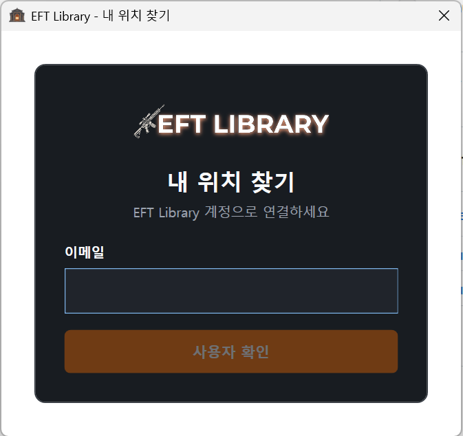
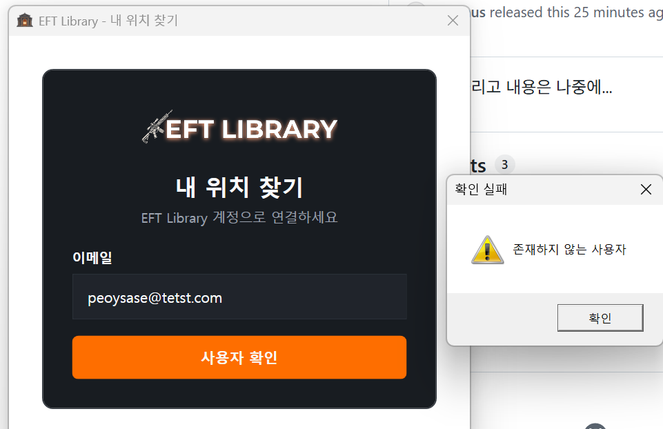
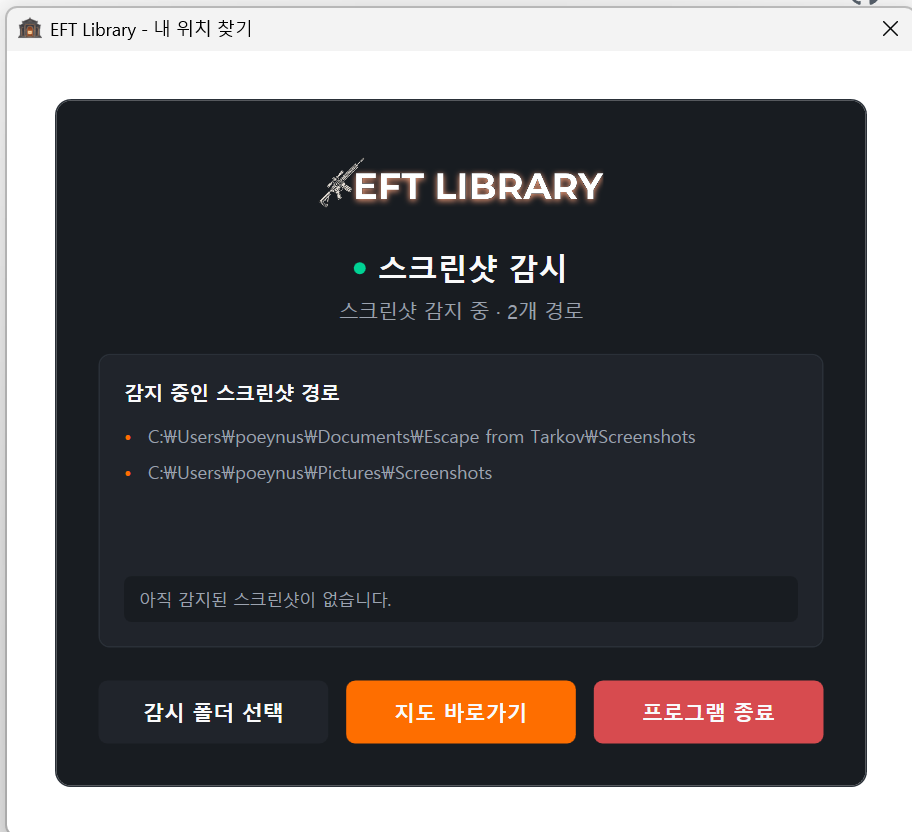
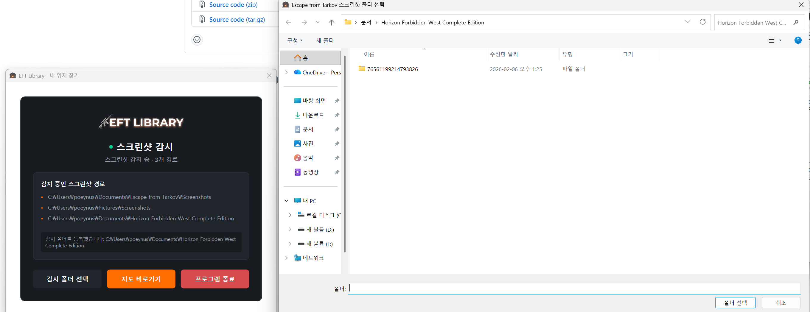
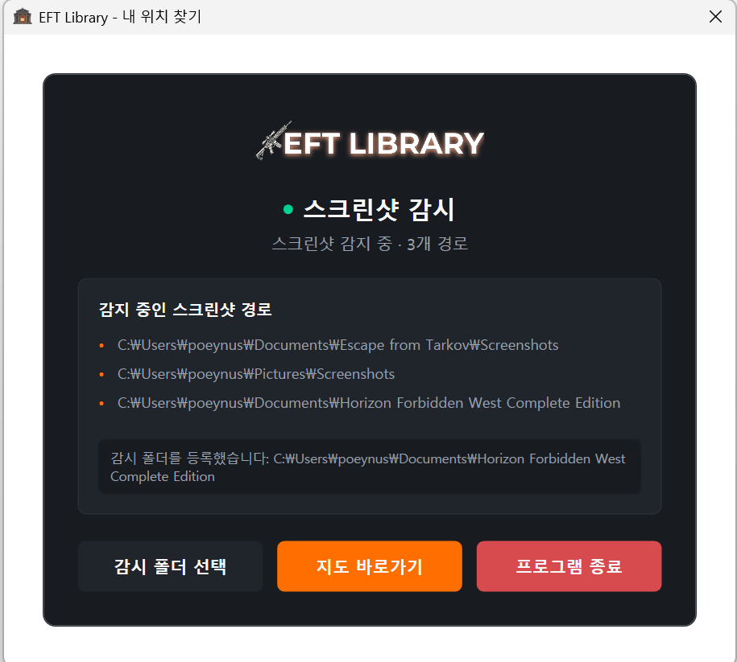
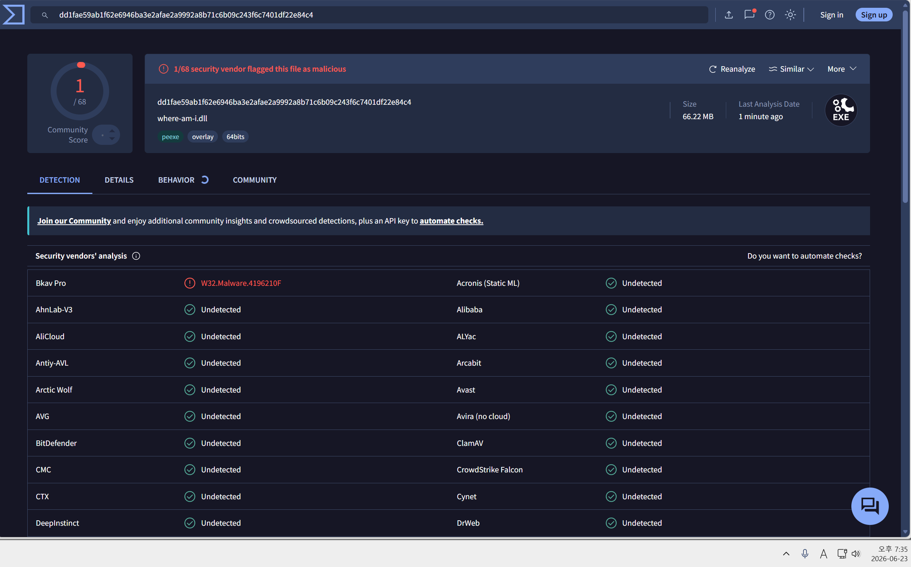
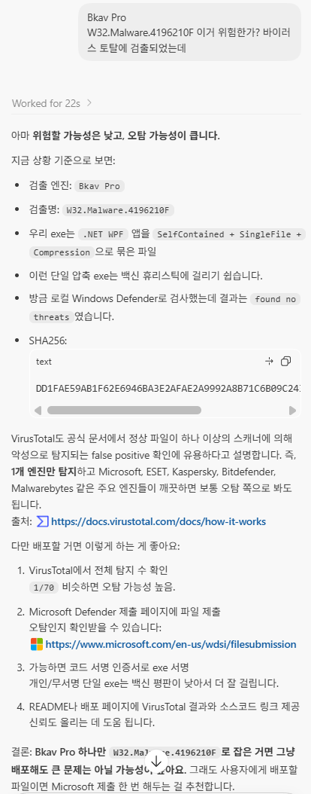

# EFT Library 내 위치 찾기 사용법

게임 스크린샷 파일명의 위치 정보와 로그에서 감지한 맵·레이드 타이머 기준을 EFT Library에 전달하는 Windows 프로그램입니다.

이 문서는 현재 개발 소스 기준입니다. 배포 파일에는 아직 반영되지 않았을 수 있으며, 아래 이미지는 개편 전 화면입니다.

> 스크린샷 이미지와 원본 게임 로그는 업로드하지 않습니다. 이메일·위치가 담긴 파일명·감지한 맵·레이드 타이머 기준을 전송합니다. 자동 탐색 개선을 위해 직접 지정한 폴더 경로도 사용자 폴더명·이메일 형태를 가려 별도 수집합니다. 타이머의 서버 수신·웹 BTR 자동 적용은 별도 구현이 필요합니다.

## 1. 프로그램 실행

배포받은 압축 파일을 원하는 폴더에 푼 다음 <code>where-am-i.exe</code>를 실행합니다.

Windows에서 보안 경고가 표시되면 게시자와 파일 출처를 확인한 후 실행해 주세요.

프로그램을 처음 실행하면 EFT Library 계정으로 연결하기 위한 이메일 입력 화면이 표시됩니다.

## 2. 사용자 확인

EFT Library에서 사용하는 이메일을 입력한 후 **사용자 확인** 버튼을 누릅니다. 사용하는 이메일은 EFT Library 사이트의 마이페이지에서 확인할 수 있습니다.

- 등록된 사용자라면 스크린샷 감시 화면으로 이동합니다.
- 확인에 실패하면 입력한 이메일이 맞는지 확인해 주세요.
- 서버 통신 오류가 표시되면 인터넷 연결을 확인한 후 다시 시도해 주세요.
- **이메일 저장**을 체크하면 사용자 확인 성공 후 이메일이 이 PC에 저장되어 다음 실행 때 자동으로 입력됩니다. 체크를 해제하고 사용자 확인을 완료하면 저장된 이메일이 삭제됩니다.

등록되지 않은 이메일을 입력하면 **존재하지 않는 사용자** 알림이 표시됩니다.

사용자 확인에 성공하면 자동으로 스크린샷 감시 화면으로 이동합니다.

## 3. 스크린샷 폴더 확인

사용자 확인이 끝나면 프로그램이 다음 위치에서 스크린샷 폴더를 자동으로 찾습니다.

- Escape from Tarkov 기본 스크린샷 폴더
- Windows 문서 폴더 및 OneDrive로 이동된 문서 폴더
- Windows 사진 폴더
- Steam 버전 Escape from Tarkov 스크린샷 폴더
- 이전에 사용자가 직접 선택한 폴더

정상적으로 찾으면 화면에 **스크린샷 감지 중** 메시지와 현재 감시 중인 경로가 표시됩니다.

감시 화면에서는 현재 감시 중인 스크린샷 경로와 최근 상태 메시지를 확인할 수 있습니다.

## 4. 폴더가 자동으로 검색되지 않을 때

화면에 스크린샷 폴더를 찾지 못했다는 메시지가 표시되면 다음 순서로 직접 등록합니다.

1. 스크린샷 위치 카드 상단의 **스크린샷 폴더 선택** 버튼을 누릅니다.
2. Escape from Tarkov 스크린샷이 저장되는 폴더를 선택합니다.
3. 화면의 감시 경로 목록에 선택한 폴더가 추가됐는지 확인합니다.

일반적인 기본 경로는 다음과 같습니다.

    C:\Users\사용자명\Documents\Escape from Tarkov\Screenshots

OneDrive를 사용하는 경우 다음과 비슷할 수 있습니다.

    C:\Users\사용자명\OneDrive\Documents\Escape from Tarkov\Screenshots

선택한 경로는 PC에 저장되므로 다음 실행부터 자동으로 사용됩니다.

폴더 선택 창에서 Escape from Tarkov 스크린샷이 저장되는 폴더를 선택합니다.

폴더가 정상 등록되면 감시 경로 목록에 새 경로가 추가되고, 하단 상태 메시지에 등록된 경로가 표시됩니다.

## 5. 게임에서 현재 위치 전송

1. 프로그램을 종료하지 않고 실행해 둡니다.
2. EFT Library의 내 위치 찾기 지도를 엽니다.
3. Escape from Tarkov 레이드에 진입합니다.
4. 게임의 스크린샷 키로 스크린샷을 촬영합니다.
5. 프로그램 화면에 **스크린샷 전송 완료** 메시지가 표시되는지 확인합니다.
6. EFT Library 지도에서 현재 위치가 갱신됐는지 확인합니다.

> Windows 캡처 도구나 다른 프로그램으로 만든 일반 이미지는 위치 좌표가 없으므로 전송되지 않습니다. Escape from Tarkov 게임 자체의 스크린샷 기능을 사용해 주세요.

프로그램이 실행 중이면 새 스크린샷을 감지해 위치 정보를 서버로 전송합니다. 전송이 완료되면 최근 상태 메시지가 갱신됩니다. 여러 장을 빠르게 촬영하면 대기 중인 중간 위치를 생략하고 최신 스크린샷을 우선 전송합니다. 일시 통신 오류는 최대 3회 시도합니다. 최종 실패 뒤에는 새 스크린샷을 촬영해 주세요.

## 6. 시스템 트레이에서 실행

창의 최소화 버튼을 누르면 프로그램이 작업 표시줄 대신 시스템 트레이로 이동하며 스크린샷 감시는 계속됩니다.

- 트레이의 EFT Library 아이콘을 더블클릭하거나 **열기**를 선택하면 창이 다시 표시됩니다.
- 창의 닫기 버튼을 누르거나 트레이 메뉴에서 **종료**를 선택하면 프로그램이 종료됩니다.

## 7. 상태 화면과 최근 활동

로고 오른쪽에서 **현재 맵 열기**·**프로그램 종료**를 실행합니다. 버전 정보는 제목 오른쪽의 **앱 버전** 버튼으로 확인합니다.

- 사용자 확인 후 실행 중에는 스크린샷·로그를 자동으로 감지합니다. 감지 시작·중지 버튼은 없으며, 과거에 중지 상태를 저장했어도 자동으로 시작합니다. 자동 감지 표시는 서버 전송 성공을 뜻하지 않습니다. 종료하면 파일 준비 대기와 전송·재시도도 취소합니다.
- 레이드 영역에서 감지한 맵·시작, 타이머 확보 여부, 레이드 요청 전송 결과를 확인합니다. 타이머는 **기록 당시 값**이며 실시간 카운트다운이 아닙니다.
- 스크린샷 위치 영역에서 감시 상태와 위치 전송 결과를 확인합니다. 레이드 정보와 스크린샷 위치의 전송 결과는 각각 표시됩니다.
- 스크린샷 위치 영역의 **스크린샷 경로 보기**에서 스크린샷 감시 폴더·경로 수집 상태를 확인합니다. 로그 수집 영역의 **로그 경로 보기**에는 실제 로그 실행 폴더·로그 경로 수집 상태만 표시합니다. 긴 경로는 마우스를 올려 전체를 확인합니다.
- 로그 폴더는 기본적으로 자동 탐색합니다. 저장된 지정 경로가 있다면 그 범위만 감시합니다. 로그 감지 대기가 계속되면 로그 수집 카드 상단의 **로그 폴더 선택**으로 지정합니다. 예시 경로는 `C:\Battlestate Games\EFT\Logs`이며 설치 위치에 따라 다릅니다.
- **최근 활동**은 최대 100개이며 최신 항목부터 표시합니다. **오류만**을 선택하면 이전 실패를 찾을 수 있습니다. 이력은 프로그램을 종료하면 사라집니다.
- **현재 맵 열기**는 감지한 맵을 엽니다. 별칭 변환이 필요하거나 맵을 확인하지 못했다면 내 위치 찾기 진입점을 엽니다.
- 창 크기를 조절하거나 화면을 스크롤할 수 있습니다. 좁은 창에서는 하단 버튼이 다음 줄로 이동합니다.

타이머가 없으면 웹의 수동 입력을 유지합니다. “타이머 포함 요청 전송 완료”는 웹의 BTR 화면 반영 완료를 의미하지 않습니다. 서버·웹 구현 상태는 별도로 확인해야 합니다.

직접 지정한 로그 경로가 있으면 해당 범위만 감시합니다. 접근할 수 없으면 자동 후보로 우회하지 않고 기다리므로 잘못 지정했다면 다시 선택해 주세요. 상위 `C:\Battlestate Games\EFT\Logs`를 선택하는 것이 좋습니다. Logs 바로 아래의 일반적인 실행 폴더를 직접 선택한 경우에도 부모 Logs에서 다음 실행을 찾습니다.

새 실행 폴더에 application 로그가 생기면 다음 확인 주기에 전환하고 이전 맵·타이머를 비웁니다. 과거 로그를 수정해도 이전 실행으로 돌아가지 않습니다. 상태에서 사용자 지정·자동 탐색 여부와 실제 실행 폴더를 확인합니다. 게임 프로세스 실행 여부까지 판단하지는 않습니다.

## 8. 사용자 지정 경로 수집

직접 지정한 스크린샷·로그 경로를 자동 폴더 탐색 개선에 사용합니다. 현재 사용자 프로필과 Windows 사용자 폴더명은 `<user>`, 이메일 형태는 `<account>`로 가려 전송합니다. 별도 수집 요청에는 이메일·사용자 ID를 포함하지 않습니다. 임의 폴더명·서버/공유명은 남을 수 있습니다.

기존 사용자는 업데이트 후 사용자 확인에 성공하면 PC에 저장된 경로 중 아직 수집하지 않은 항목이 보고됩니다. 완료한 경로는 반복 전송하지 않고, 실패한 항목은 다음 실행의 사용자 확인 후 다시 시도합니다. 각 카드의 **스크린샷 경로 보기**·**로그 경로 보기**에서 해당 경로의 수집 상태를 확인할 수 있습니다.

수집 실패는 PC의 경로 저장과 감지 동작에 영향을 주지 않습니다. 프로그램 종료 시 진행 중 보고를 취소합니다. 실제 감지에는 원본 로컬 경로를 사용하고, 서버에서 경로를 가져와 복원하지 않습니다.

## 9. 앱 버전 확인

상단 오른쪽 **앱 버전** 버튼을 누르면 별도 창에서 현재 실행 버전과 업데이트 상태를 확인합니다. **닫기** 또는 Esc로 닫습니다. 버전 확인은 사용자 확인 후 자동으로 진행하며, 창의 **다시 확인** 버튼으로 수동 조회합니다. 조회 중에는 중복 확인을 막으며, 감지와 버전 확인은 독립적으로 진행합니다.

새 버전이 있고 유효한 공식 주소를 받으면 **다운로드 페이지** 버튼이 활성화됩니다. 버튼은 공식 HTTPS 페이지를 브라우저로 엽니다. 프로그램이 자동으로 설치되거나 실행 파일이 교체되지는 않습니다. 필수 업데이트 표시는 현재 안내이며 감지를 자동 차단하지 않습니다.

버전 확인에 실패하면 최신 버전으로 표시하지 않습니다. 감지와 위치 전송은 계속 사용할 수 있습니다. **현재는 백엔드 버전 API가 아직 구현되지 않아 확인 실패가 표시될 수 있습니다.** 서버 구현·배포 후 실제 업데이트 정보를 확인해야 합니다.

## 바이러스 검사 참고

아래 이미지는 과거 배포 파일의 검사 결과입니다. 이번 빌드는 별도로 검사해야 하며 과거 결과가 새 파일의 검사 결과를 의미하지 않습니다.

검사 결과에서 1개 엔진만 악성으로 표시되는 경우는 단일 파일 exe 배포 특성상 오탐일 수 있습니다. Microsoft Defender 등 주요 엔진이 정상으로 표시되는지 함께 확인해 주세요.

백신이 파일을 차단한다면 VirusTotal 전체 결과와 Windows Defender 검사 결과를 확인한 뒤 실행 여부를 판단해 주세요.

## 상태 메시지 안내

| 메시지 | 의미 및 조치 |
| --- | --- |
| 스크린샷 감지 중 | 표시된 폴더를 정상적으로 감시하고 있습니다. |
| 스크린샷 폴더를 찾지 못했습니다 | **스크린샷 폴더 선택**으로 직접 등록해 주세요. |
| 스크린샷 전송 완료 | 해당 위치 요청에 대해 서버 성공 응답을 받았습니다. 웹 지도 반영은 별도로 확인합니다. |
| 파일 준비 실패 | 파일을 읽을 수 없거나 빈 상태가 지속됐습니다. 경로·권한을 확인하고 다시 촬영해 주세요. |
| 스크린샷 위치 재전송 중 | 일시 오류로 재시도합니다. 최대 3회까지 시도합니다. |
| 서버 전송 실패 | 서버 응답에 문제가 있습니다. 잠시 후 다시 시도해 주세요. |
| 서버 통신 오류 | 인터넷 연결이나 서버 상태를 확인해 주세요. |
| 감시 오류 | 프로그램이 자동으로 경로 재연결을 시도합니다. |

## 문제가 해결되지 않을 때

다음 항목을 순서대로 확인해 주세요.

1. 프로그램 화면에 감시 경로가 한 개 이상 표시되는지 확인합니다.
2. 실제 스크린샷 파일이 표시된 경로에 생성되는지 확인합니다.
3. Windows 캡처 도구가 아닌 게임 자체 스크린샷 기능을 사용했는지 확인합니다.
4. 파일명에 좌표로 보이는 숫자 세 개가 포함되어 있는지 확인합니다.
5. 프로그램을 종료한 후 다시 실행합니다.
6. 방화벽이나 보안 프로그램이 서버 연결을 차단하고 있지 않은지 확인합니다.

문의할 때는 다음 정보를 함께 전달하면 문제 확인에 도움이 됩니다.

- Windows 버전
- 게임 실행 방식: Steam 또는 BSG Launcher
- 프로그램에 표시된 감시 경로
- 프로그램의 마지막 상태 메시지
- 생성된 스크린샷 파일명

> 이메일, Windows 사용자 이름 등 개인정보는 가린 후 공유해 주세요.

## 로그 지도 이름과 웹 지도

앱은 `bigmap`, `city`, `Rezerv_Base`처럼 로그에 기록된 맵 이름을 그대로 표시·전송합니다. 별칭 변환은 백엔드가 처리하며 앱은 별칭 목록을 조회하거나 캐시하지 않습니다. 맵 이름과 유효한 레이드 시작·타이머가 있으면 함께 전송합니다. 서버 별칭 DB가 미등록 이름을 처리하지 못하면 요청이 실패할 수 있으므로 해당 별칭을 서버에 등록해 주세요.

현재 맵 열기에서 로그 이름과 웹 경로가 일치하면 해당 지도를 열고, 변환이 필요한 이름은 내 위치 찾기 진입점을 엽니다. 웹 자동 맵 감지가 켜져 있으면 백엔드가 전달한 정식 맵으로 이동합니다.
